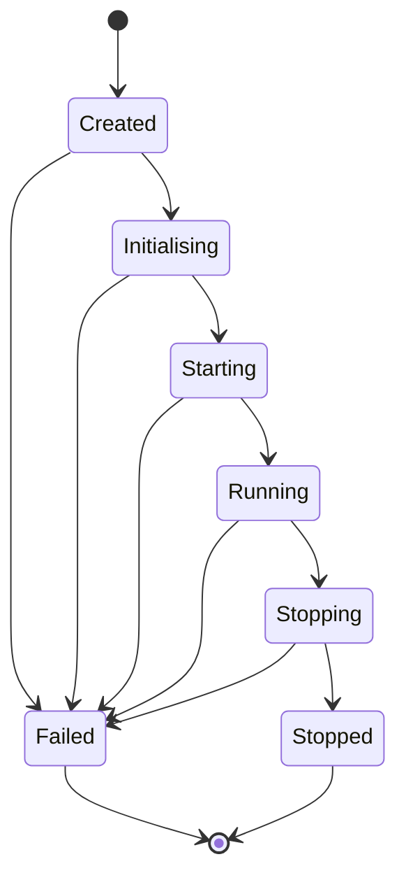

# Application Lifecycle

## Scope

Application lifecycle coordinates startup/shutdown state and notifications while Generic Host remains the actual owner of hosted services, cancellation, and resource disposal.

## States

| State | Meaning |
|---|---|
| Created | Coordinator exists; host configuration is not yet active |
| Initialising | Validated configuration and process-owned diagnostics are established |
| Starting | Hosted services are starting in registration order |
| Running | All hosted services before the readiness boundary started successfully |
| Stopping | New external work must stop; Generic Host is draining services in reverse order |
| Stopped | All registered hosted services completed, and the host can dispose |
| Failed | Startup/runtime/shutdown failed and readiness is unavailable |

Invalid transitions throw `InvalidApplicationLifecycleTransitionException`.

## Startup and shutdown ordering

Two hosted services form the lifecycle boundary:

1. `FoundationHostedService` is registered first. It changes `Created -> Initialising -> Starting`.
2. Project/service hosted registrations start after it.
3. `ApplicationReadinessHostedService` is registered last. It changes `Starting -> Running` only after the other services started.
4. During stop, the last registered readiness service runs first and changes `Running -> Stopping`.
5. Registered services stop/drain in Generic Host reverse order.
6. `FoundationHostedService` runs last and changes `Stopping -> Stopped`.

This avoids claiming readiness before all services start or keeping readiness enabled while services drain.

## Notifications

Accepted transitions are represented by `ApplicationLifecycleTransition` and sent to `IApplicationLifecycleObserver` implementations sequentially. Notifications:

- receive the previous/current state, reason, and timestamp;
- observe cancellation;
- are ordered by DI registration;
- must return bounded asynchronous work;
- must not mutate core state directly.

An observer failure during startup/shutdown marks the application `Failed` and propagates to Generic Host. No catch-and-continue fallback is used for critical lifecycle notifications.

## Failure behavior

`ServerApplication.RunAsync` is the process boundary. It:

- returns `0` after normal host completion;
- returns `1` for options/startup/runtime exceptions;
- writes the complete exception to standard error;
- disposes the host in `finally`.

Configuration failures occur at host build/start validation. Future hosted-service exceptions use `BackgroundServiceExceptionBehavior.StopHost`.

## Resource ownership

- The composition root owns `IHost`.
- DI owns singleton `InfiniteSkyDiagnostics` and disposes it at host disposal.
- Hosted services own their cancellation and resources.
- The application coordinator has no unmanaged resources.
- Future connections/streams must be owned by a connection or hosted service, not by `Program`.

## Current limitations

No packet listener, game-data initializer, database probe, world actor, or game loop is registered. Running therefore means the infrastructure foundation is ready, not that an MMORPG server is playable.
