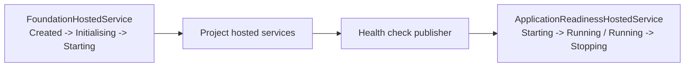

# Background Services

## Convention

Future asynchronous loops should inherit `CoordinatedBackgroundService` or implement `IHostedService` when startup/stop ordering differs materially.

`CoordinatedBackgroundService`:

- receives `ApplicationLifecycleCoordinator` and `ILogger`;
- owns a cancellation-aware execution method;
- treats cancellation as normal shutdown;
- logs programming/operational faults at Critical;
- marks lifecycle `Failed`;
- rethrows the task fault so Generic Host observes it.

`HostOptions.BackgroundServiceExceptionBehavior` is set to `StopHost`. A fault cannot leave a partially initialized process running.

## Cancellation

Loop bodies must:

1. accept the hosted-service cancellation token;
2. pass it to timers/channels/I/O;
3. check cancellation at natural boundaries;
4. release owned resources in `finally`/disposal;
5. complete within the configured shutdown timeout.

## Anti-patterns

Do not:

- start `Task.Run` and discard the returned task;
- use a `Thread` or blocking loop for ordinary async work;
- use `async void`;
- catch all exceptions and continue silently;
- access sockets/MongoDB directly from a domain loop;
- use a singleton service provider as a global object container;
- block a zone/host actor on database or external I/O.

## Registration order

The lifecycle boundary is last on startup and first on shutdown:

Shutdown runs in reverse, ending with `FoundationHostedService` changing `Stopping -> Stopped`.

No game loop is registered by this stage.
