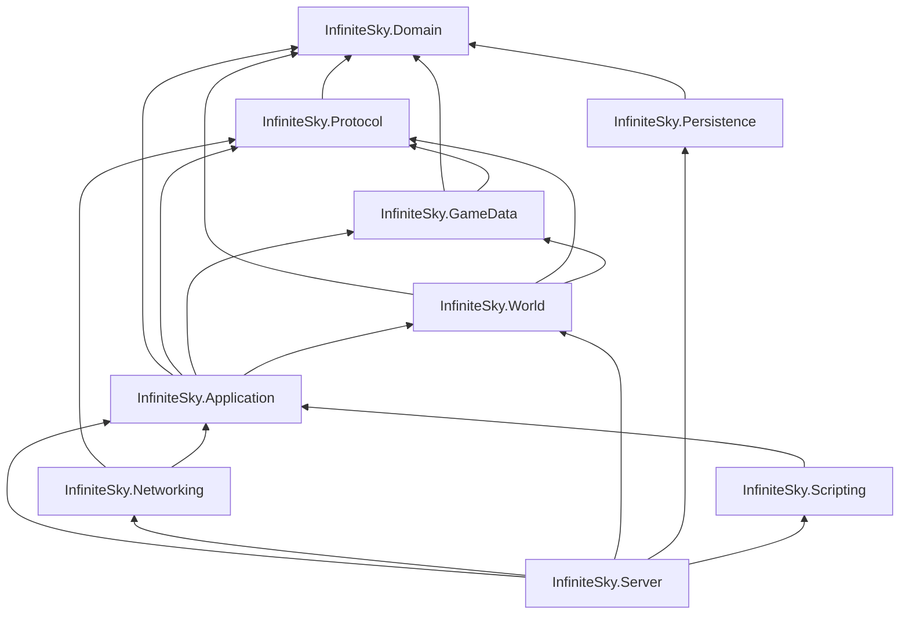
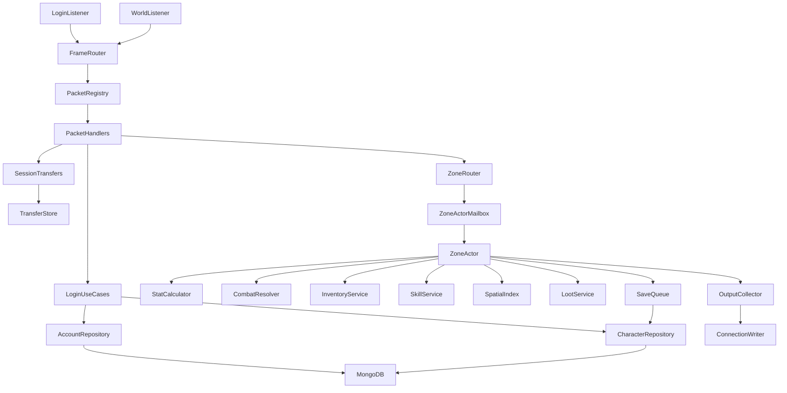
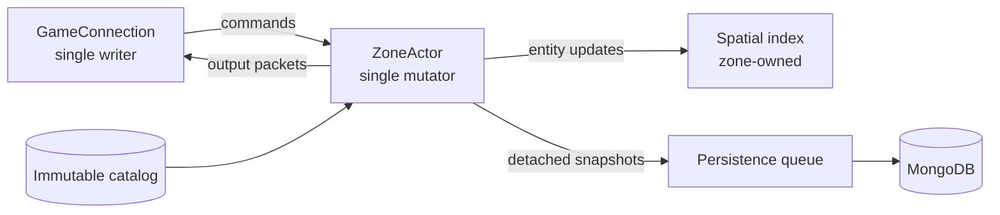
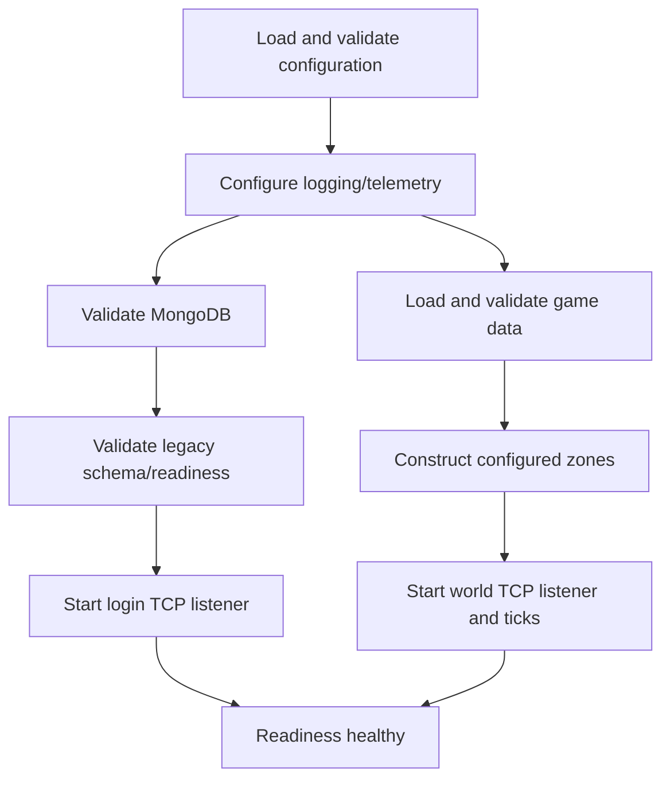
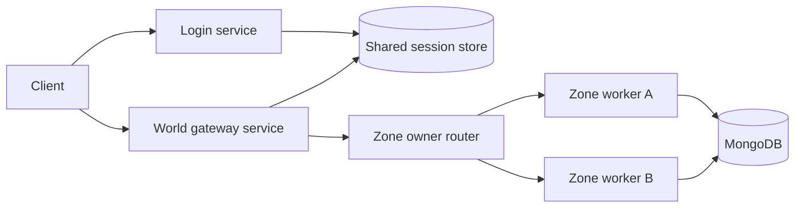

# InfiniteSky Dependency Graph

## Project dependencies

The arrow direction is "depends on."

## Dependency rules

1. `Domain` has no project dependencies.
2. `Protocol` must not depend on persistence, networking, MongoDB, or the host.
3. `GameData` must not depend on persistence or gameplay packet handlers.
4. `World` must not depend on MongoDB or sockets.
5. `Persistence` maps `Domain`; it must not map world runtime actors or protocol packets.
6. `Networking` does not own login, inventory, combat, or zone business rules.
7. `Application` knows use cases, not BSON or TCP implementation types.
8. `Server` is the only project that joins every adapter.
9. No test project may be referenced by production code.

## Runtime component graph

## Ownership boundaries

- A connection can submit commands to at most one active zone at a time.
- A zone actor can emit outputs for multiple connections.
- Only the connection owns its writer.
- Only the zone owns entity state.
- Only a persistence queue performs database writes.

## Startup dependency graph

Readiness is not enabled until both required data and persistence are usable.

## Migration dependency strategy

The first C# deployment is a single host. If later split:

That split is intentionally deferred. The first design does not add distributed locking, service discovery, gRPC, a message broker, or a shared entity cache.

## Dependency injection policy

Register concrete, singleton/scoped/transient lifetimes intentionally:

- `GameDataCatalog`: singleton, immutable.
- stat/damage/loot services: singleton when they hold no mutable state.
- repositories: singleton-safe where the driver client is reused.
- listeners: hosted services/singleton.
- zone actors: singleton per configured zone.
- `GameConnection`: per accepted connection, not a DI scope.
- `TimeProvider` and random services: injectable abstractions for deterministic tests.

Do not create a DI container inside the zone actor or resolve services per packet.

## Package strategy

Use:

- official MongoDB C# driver in `Persistence`;
- BCL Pipelines/Channels/DI/logging/options in runtime projects;
- OpenTelemetry packages only in server/diagnostic composition;
- no mediator, CQRS, ORM wrapper, generic repository package, or actor framework for the first version.

Package references stay in the narrowest project that needs them.

## Forbidden references

| Project | Must not reference |
|---|---|
| `Domain` | Any other project |
| `Protocol` | MongoDB, sockets, World, Host |
| `GameData` | MongoDB, sockets, Hosting |
| `World` | MongoDB, sockets, Hosting |
| `Persistence` | Protocol, Networking, World runtime |
| `Networking` | MongoDB, game-data parsers |
| `Server` | None forbidden, but contains no rules |

Automated architecture tests should enforce these directions.
