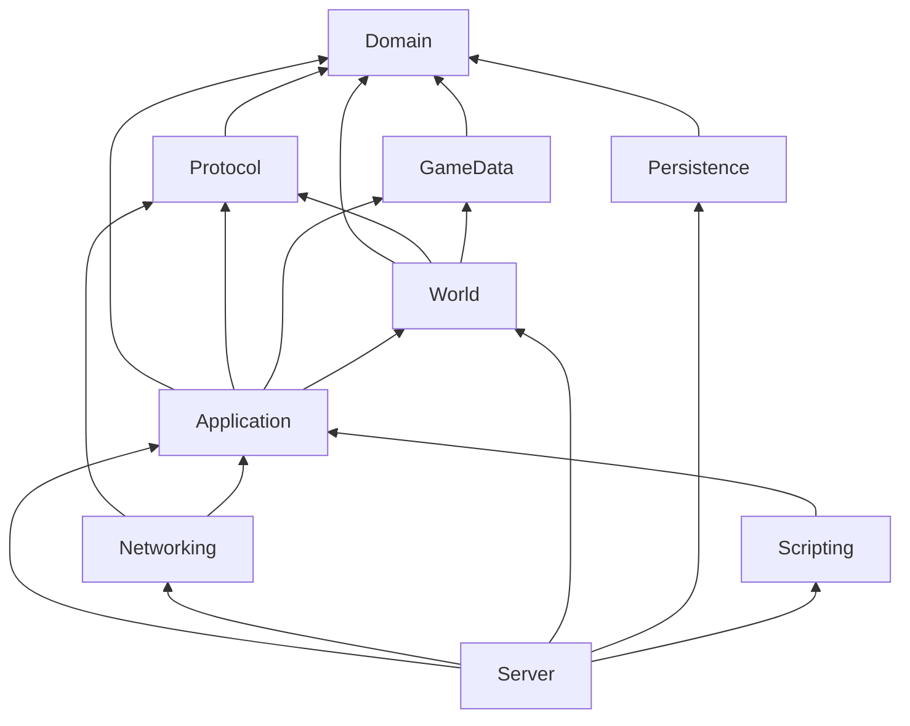

# .NET 10 Foundation Implementation

## Scope

This stage implements the approved solution shell, build system, Generic Host, configuration validation, lifecycle diagnostics, and developer verification.

It intentionally does not implement:

- TCP protocol listeners or packet codecs;
- MongoDB repositories;
- `.IMG`, spawn, or translation readers;
- entities, zones, simulation, inventory, combat, or scripts.

The original Node.js implementation is unchanged.

## Solution

`InfiniteSky.sln` contains nine production projects and six test projects.

### Production projects

| Project | Responsibility |
|---|---|
| `InfiniteSky.Domain` | Future pure domain models and rules; no infrastructure dependency |
| `InfiniteSky.Protocol` | Future binary framing and codecs |
| `InfiniteSky.GameData` | Future original game-data readers and catalog |
| `InfiniteSky.Persistence` | Future MongoDB/BSON adapters |
| `InfiniteSky.Networking` | Future TCP transport |
| `InfiniteSky.World` | Future zone actors and simulation |
| `InfiniteSky.Application` | Application lifecycle boundary and future use cases |
| `InfiniteSky.Scripting` | Future isolated extension host |
| `InfiniteSky.Server` | Executable Generic Host composition root |

### Test projects

- `InfiniteSky.Domain.Tests`
- `InfiniteSky.Protocol.Tests`
- `InfiniteSky.World.Tests`
- `InfiniteSky.GameData.Tests`
- `InfiniteSky.Persistence.Tests`
- `InfiniteSky.Server.IntegrationTests`

The subsystem test projects are scaffolding for their approved future suites. Meaningful foundation tests currently cover host composition, options, readiness, startup, and shutdown in `InfiniteSky.Server.IntegrationTests`.

## Dependency graph

Production references follow the approved dependency graph:



The dependency direction is "depends on." The solution build is acyclic. Production code is not referenced by a test project except through normal one-way test-to-production references.

## Shared build configuration

- `global.json` selects .NET SDK 10.0.401 with feature roll-forward.
- `Directory.Build.props` centralizes `net10.0`, C# latest, nullable and implicit usings, deterministic builds, analyzers, and warning-as-error.
- `Directory.Packages.props` centralizes all NuGet test package versions.
- `.editorconfig` establishes C# XML/JSON/YAML/PowerShell formatting.
- `Directory.Build.targets` was not needed; no project-specific post-build behavior exists.

The runtime uses only the BCL and the shared ASP.NET Core framework reference in the server executable. Test projects use centrally managed xUnit, the Microsoft test SDK, and coverage collection.

## Hosting

`InfiniteSky.Server.Program` delegates immediately to `ServerHostBuilder`.

`ServerHostBuilder`:

- creates `HostApplicationBuilder`;
- loads standard appsettings and environment providers;
- adds the `INFINITESKY_` environment variable prefix;
- binds and validates `InfiniteSkyOptions` on start;
- registers `FoundationHostedService` as both `IHostedService` and `IApplicationReadiness`.

`FoundationHostedService` owns no network/database implementation. It records:

- lifecycle phase;
- readiness;
- configuration validity;
- hosting running/stopped state;
- explicit `DisabledByFoundation` states for network/database.

It never reports an untested external service as healthy. If future packet/database implementation is enabled before it exists, options validation fails startup with an explicit foundation-stage error.

Application lifecycle now uses the explicit `Created`, `Initialising`, `Starting`, `Running`, `Stopping`, `Stopped`, and `Failed` states. A first hosted-service hook initializes the process, a last hosted-service hook publishes readiness, and Generic Host remains responsible for service ordering, cancellation, and disposal. See [APPLICATION_LIFECYCLE.md](APPLICATION_LIFECYCLE.md).

## Configuration

Sections under `InfiniteSky`:

| Section | Purpose |
|---|---|
| `Application` | server name, graceful shutdown timeout |
| `Networking` | reserved login/world endpoint settings; disabled |
| `Database` | provider and secret-ready connection string; disabled |
| `World` | legacy tick interval |
| `Zones` | future zone load IDs |
| `Gameplay` | `LegacyParity` or `Corrected` profile |

Environment variables use standard double-underscore hierarchy:

```text
INFINITESKY_InfiniteSky__Application__Name
INFINITESKY_InfiniteSky__Database__ConnectionString
```

The tracked JSON files contain no secrets. Production credentials should be supplied by the environment or a deployment secret provider, never committed.

## Logging and diagnostics

Logging uses `Microsoft.Extensions.Logging`. Startup and shutdown use source-generated structured logging to satisfy the analyzer policy and avoid hot-path argument evaluation.

Diagnostics currently report only the lifecycle and explicitly disabled future services. Packet metrics, MongoDB health, world timing, and OpenTelemetry export remain future migration work.

## Tests

Foundation tests verify:

- default configuration binding;
- environment-variable override;
- invalid tick configuration fails startup;
- enabling unimplemented networking/database fails validation;
- Generic Host starts and becomes ready;
- one hosted-service/readiness instance is registered;
- graceful stop transitions readiness to stopped.

Run:

```powershell
dotnet test InfiniteSky.sln --no-restore
```

## Developer workflow

From the repository root:

```powershell
.\scripts\build.ps1
.\scripts\test.ps1
.\scripts\format.ps1
dotnet run --project src\InfiniteSky.Server\InfiniteSky.Server.csproj
```

GitHub Actions performs restore, Release build, tests, and `dotnet format --verify-no-changes` on Ubuntu and Windows. A local Linux-x64 publish build is used as a cross-platform compile check when WSL or a Linux host is unavailable.

## Migration evidence

Foundation work advances only:

- `INF-001` Generic-host executable: verified by host integration tests;
- `INF-002` strong configuration model: verified by binding/validation/environment tests;
- `INF-009` structured logging: implemented; full correlation/redaction coverage remains future work.
- `INF-006` graceful shutdown coordination: implemented for the foundation lifecycle; network/database drain remains future work.
- `INF-011` failure policy: implemented for lifecycle, observer, background-service, and process failure; zone failure isolation remains future work.

Protocol, networking, persistence, data, world, gameplay, scripting, and administration functionality remain `NOT_STARTED`.
