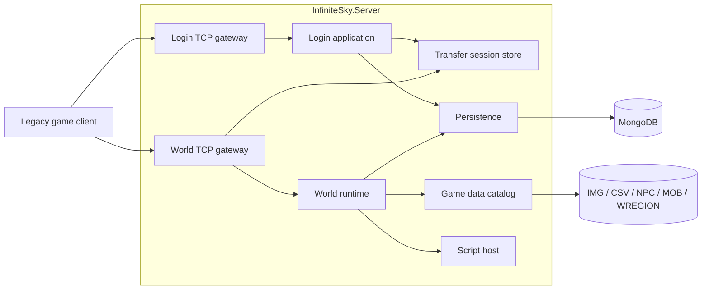
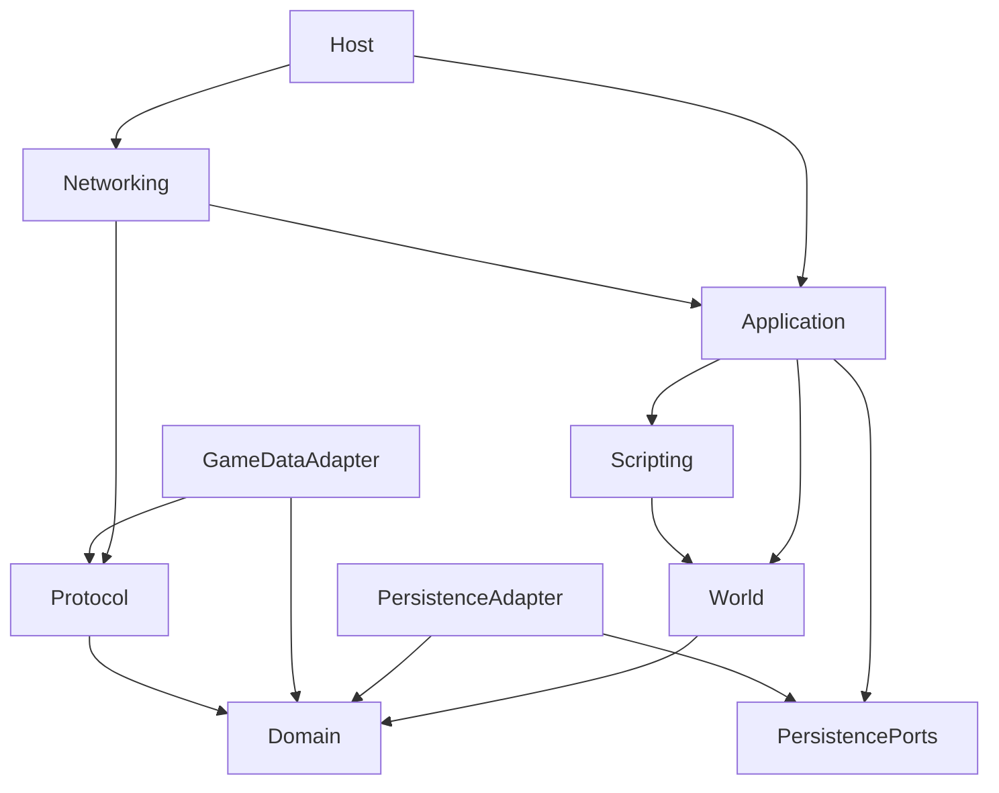
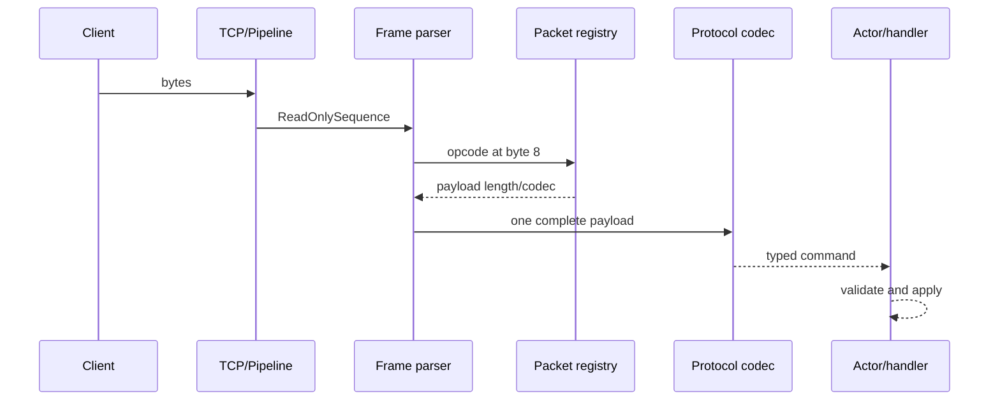
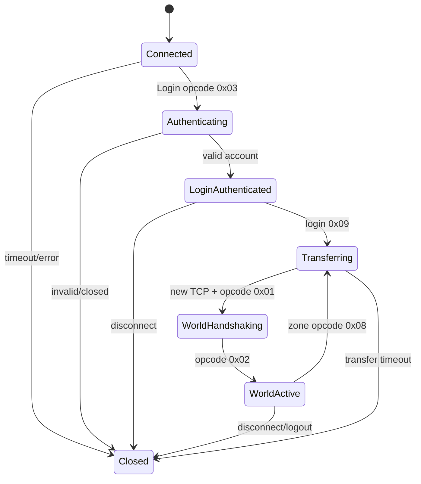
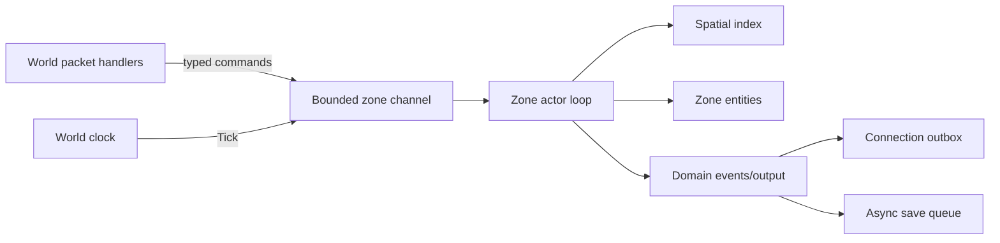
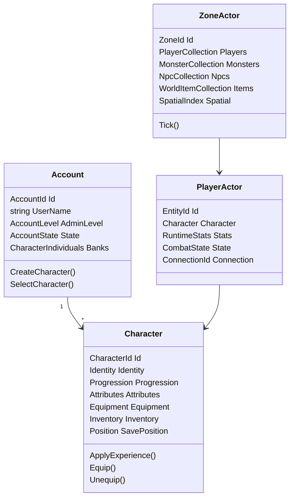
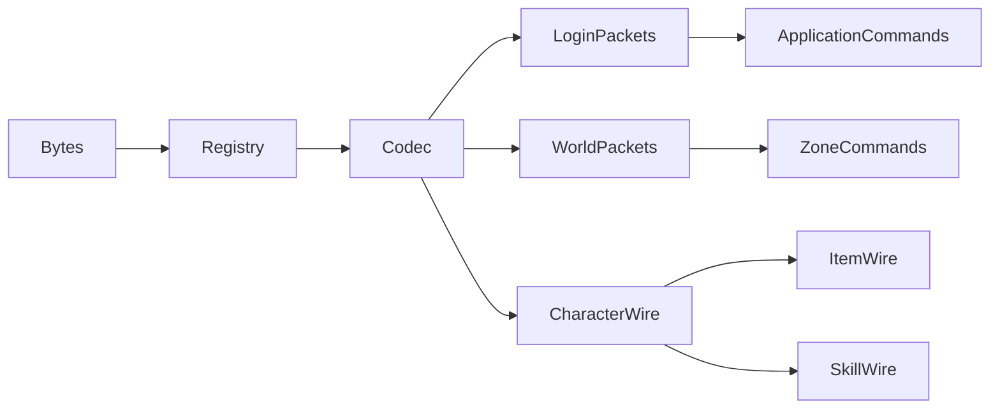
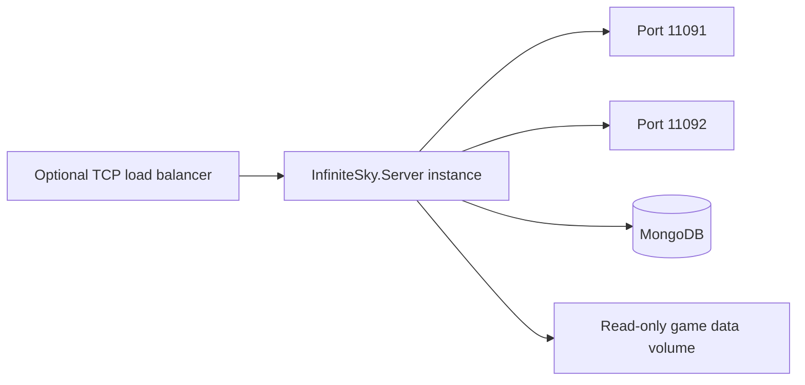

# InfiniteSky .NET 10 Solution Architecture

## Evidence basis

This design is constrained by the completed source analyses:

- [Repository protocol specification](../protocol/PROTOCOL_SPECIFICATION.md)
- [Packet catalogue](../protocol/PACKET_CATALOGUE.md)
- [Gameplay systems](../analysis/GAMEPLAY_SYSTEMS.md)
- [Game data formats](../analysis/GAME_DATA_FORMATS.md)
- [Gameplay flows](../analysis/GAMEPLAY_FLOWS.md)

Where the legacy implementation is incomplete or ambiguous, this architecture introduces explicit compatibility boundaries rather than assigning guessed semantics.

## Goals

The .NET 10 implementation must:

- preserve the existing client/server wire protocol and visible login/world behavior;
- preserve existing MongoDB account, character, guild, inventory, storage, bank, and counter semantics where possible;
- load original `.IMG`, `.NPC`, `.MOB`, `.WREGION`, and CSV game data;
- isolate binary protocol details from gameplay;
- provide deterministic, testable gameplay rules;
- avoid the legacy global-object, callback, and hot-reload failure modes;
- run as one host initially, with a migration path to multiple world workers later.

The target is a modernization, not a rewrite of the protocol or a silent balance change.

## Architectural style

Use a modular monolith with three runtime boundaries inside one process:

1. **Login gateway** — accepts login connections and character-management/login packets.
2. **World gateway** — accepts world connections, resolves session transfers, and owns connection I/O.
3. **World runtime** — owns zones, entities, simulation, timers, and persistence coordination.

Each boundary has clear dependencies, but deployment starts as a single executable. Splitting login and world into separate processes should not require rewriting the domain model or packet codecs.

## Layered responsibilities

- **Host** composes concrete services and configures listeners/workers.
- **Networking** performs asynchronous socket I/O and maps bytes to protocol commands.
- **Protocol** owns framing, codecs, packet fixtures, and byte compatibility.
- **Application** coordinates login, session transfer, command dispatch, and persistence boundaries.
- **World** owns simulation entities, zones, spatial queries, combat, inventory, events, and AI.
- **Domain** owns stable value types and pure business rules; it has no I/O or framework references.
- **PersistenceAdapter** maps legacy MongoDB documents to domain state.
- **GameDataAdapter** loads and indexes original binary/CSV records.
- **Scripting** is an optional boundary for reloadable commands and event scripts, never a direct owner of core state.

## Runtime packet path

### Receive

Use `System.IO.Pipelines` and per-connection `PipeReader` loops. The wire parser must preserve the legacy model:

- 9-byte receive header;
- opcode in header byte 8;
- bytes 0-7 retained as opaque;
- payload length selected by a trusted opcode registry;
- fragmented/coalesced TCP reads assembled safely;
- maximum buffered frame enforced;
- unknown opcode logged and handled according to a compatibility policy.

The parser emits an `IncomingPacket` containing connection identity, opcode, retained header, and `ReadOnlyMemory<byte>`/`Sequence` payload. Opcode handlers decode to immutable command records.

### Send

Connections own a single ordered asynchronous writer backed by `PipeWriter` or bounded channel. Domain/world code never writes directly to a socket. It returns `OutboundPacket` values or publishes connection-directed output.

Reply encoding must remain asymmetric with receive framing: ordinary replies begin directly with their reply packet ID, as the legacy server does. A separately identified compressed/state envelope may be introduced in the codec without contaminating the generic receive parser.

## Connection and session model

`GameConnection` owns:

- connection ID;
- current phase: `Connected`, `Authenticating`, `LoginAuthenticated`, `WorldHandshaking`, `WorldActive`, `Transferring`, `Closed`;
- cancellation token;
- remote endpoint;
- optional account/session claims;
- receive and send loops;
- protocol compatibility metrics.

The login server must issue world-transfer entries. Two compatibility modes are planned:

1. **Legacy transfer mode (default):** match `Name`/slot/map against an in-memory transfer queue exactly as the analyzed implementation does.
2. **Secured transfer mode (opt-in):** add a random server-side transfer token while retaining all legacy packet bytes; this requires client compatibility or a controlled external migration and is not enabled by default.

The compatibility mode belongs to configuration and the session-store implementation, not packet handlers.

## World concurrency

### Zone actor model

Every loaded zone is owned by one background actor. All state mutation for players, monsters, NPCs, items, timers, and interest in that zone occurs on that actor's logical thread.

- A `Channel<ZoneCommand>` is the mailbox.
- One reader performs commands/ticks in FIFO order.
- Calls into a zone return a result through `TaskCompletionSource` when a response is required.
- No gameplay object lock is shared across zones.
- Zone transfer is a transaction: detach from source, persist/checkpoint if required, place into target.

### Tick and timers

Use a monotonic `TimeProvider`-based clock. A fixed-step coordinator produces ticks at a configured interval; the target starts with the legacy 100 ms scheduling behavior but keeps timestep and action-rate calculations explicit.

Each zone independently advances:

1. queued network commands;
2. due timers/events;
3. movement/AI/buffs;
4. collisions/queries;
5. combat resolution;
6. visibility/delta output;
7. persistence checkpoint requests.

Timers are zone-owned. Avoid thousands of independent `Task.Delay` loops for monsters/items. Store absolute monotonic expiration times in priority collections or sorted timers.

### Staged zone ownership

The actor/mailbox remains the target for network-driven entity mutation. During the zone-management stage, the only mutable per-zone structure is the QuadTree; its operations are protected by a zone-local lock and return copied query results. No mailbox is introduced before there are zone commands to serialize. The player/entity stage must move those mutations under actor ownership or explicitly re-evaluate this staged boundary before adding them.

### World/runtime compatibility mode

Preserving existing behavior and improving correctness conflict in some known areas: client-authoritative movement, double monster damage subtraction, immediate monster heal, non-active combat handlers, and unbounded inventory mutation. Introduce explicit compatibility profiles:

- `Legacy`: reproduce current packet semantics, including imperfect rules, for protocol/behavioral parity tests.
- `Corrected` (off initially): server-side validation and completed mechanics, introduced only with fixtures and rollout configuration.

The packet wire layout does not depend on the selected gameplay profile.

## Domain model

### Identities and values

Prefer small immutable records/readonly structs:

- `AccountId`, `CharacterId`, `ZoneId`
- `EntityId` with a session/zone-local generation
- `MapPoint`/`Position3` with float X/Y/Z matching the wire
- `ClanId`, `ItemDefinitionId`, `MonsterDefinitionId`, `SkillDefinitionId`
- `Experience`, `Level`, `Quantity`

Use `uint`/`int` carefully according to each legacy field's signedness, then convert at protocol/domain boundaries. Do not expose `BsonElement` or `Buffer` concepts in domain logic.

### Aggregate boundaries

Persistent character data and runtime actor state are separated:

- `Character` is a domain aggregate/persistence projection for identity, inventory, saved location and progression.
- `PlayerActor` is ephemeral zone state with animation, target, movement, cooldowns, buffs, and connection ID.

This prevents packet animation fields and timer state from contaminating MongoDB records.

## Gameplay services

Keep specialized logic in cohesive, testable services:

- `CharacterFactory`: clan template and validation.
- `ProgressionService`: EXP thresholds, level gains, point awards.
- `StatCalculator`: level base, attributes, equipment, pets, buffs, and final stats.
- `CombatResolver`: damage, targeting, hit/defense, damage application.
- `SkillService`: learning, costs, cooldowns, buff application.
- `InventoryService`: transactional pickup/drop/move/equip/storage actions.
- `LootService`: data-driven chance/ID rolls, ownership and expiration.
- `SpawnService`: fixed spawn definitions, timers, respawn.
- `NpcService`: dialogue/shop/interactions.
- `QuestService`: added only after packet/data coverage exists; no pretend implementation in parity mode.

These services are ordinary classes with value-type inputs and explicit result records. They are not generic repositories or event frameworks by default.

## Spatial management

Retain a quadtree-like spatial index behind a narrow `ISpatialIndex` interface because spatial behavior is independently testable, but use a concrete `ZoneSpatialIndex` internally. Initially:

- X/Z coordinates;
- node IDs mapped through a `Dictionary<EntityId, SpatialEntry>`;
- update on each actor tick;
- radius queries for clients/NPCs/items;
- no global-world concurrent mutation.

Consider a uniform grid only if profiling shows quadtree replacement churn. Do not introduce ECS for this migration.

## Protocol

The protocol assembly is independent of MongoDB, gameplay, sockets, and DI.

### Components

- `PacketOpcode`: stable byte.
- `PacketDirection`: client/server.
- `PacketDescriptor`: opcode, payload length or variable decoder, codec, handler kind.
- `IBinaryReader` helpers backed by `Span<byte>`.
- `LegacyFixedString`: truncates/pads and stops at NUL.
- Hand-written codec classes generated only where it substantially removes repeated error-prone fields.
- Packet fixture tests built from hex strings and legacy fixtures.

Unknown legacy fields remain in explicit wire DTOs as reserved spans/arrays; they are not discarded if round-tripping is required.

## Data loading

`InfiniteSky.GameData` exposes an immutable `GameDataCatalog` after startup:

- read `.IMG` `uint32 recordCount + fixed records`;
- overlay translation CSV by ID;
- read spawn `.NPC/.MOB` and `.WREGION`;
- validate count/record lengths;
- store `FrozenDictionary`-style indexes after construction;
- record unknown raw bytes/fields to support later reverse engineering.

Startup fails on required data corruption. Optional translation/NPC sections may have explicit policies configured; silent defaults are not accepted.

## Persistence

The persistence boundary uses:

- MongoDB driver for direct compatibility;
- aggregate-specific repositories rather than a generic repository framework;
- explicit documents and mappers;
- tolerant legacy document readers with validation;
- batched/asynchronous character saves outside the zone actor loop;
- optimistic concurrency for corrected profiles where schema permits;
- durable operation IDs/correlation IDs for save tracing.

### Ownership and saving

Zone actors mutate in-memory state and enqueue a snapshot/save request. MongoDB I/O never blocks a zone command loop.

Save triggers:

- normal disconnect;
- explicit save/admin;
- zone transfer;
- periodic dirty-character checkpoint;
- inventory/economy mutation acknowledgement rules.

Migration tooling must compare selected legacy BSON fields with new domain serialization and support dry-run.

## Configuration

Use .NET options with validation on start:

- server/login/world endpoints;
- NAT and advertised addresses;
- MongoDB;
- game data paths;
- zone list/load flags;
- tick/cadence, network limits, interest distance;
- compatibility profile;
- drop/progression switches;
- script policy;
- diagnostics.

Configuration is layered from `appsettings.json`, environment-specific files, environment variables, and secrets. Startup validation forbids placeholder values in production.

Runtime reload is limited to safe values such as log levels and diagnostics switches. Ports, protocol mode, zone topology, and major data catalog changes require controlled restart.

## Scripting

The legacy server uses hot-reloaded JavaScript VM scripts for packets, generic behavior, commands, and plugins. The modern core must not execute gameplay scripts in the networking thread.

Recommended stages:

1. Convert bundled commands and packet handlers to C#.
2. Preserve a narrow event/command script extension API for opt-in content.
3. Load scripts through an isolated process or supported managed scripting host, with capability-limited inputs and timeouts.
4. Publish immutable command/event DTOs; scripts return explicit result commands.
5. Support controlled reload; never mutate live global objects.

Do not ship arbitrary `eval`/shared-object VM behavior for production. Existing CLI `eval`-style functionality remains an admin-only development tool, not a scripting protocol.

## Hosting, logging, and diagnostics

`InfiniteSky.Server` is a .NET Generic Host:

- starts login/world listeners;
- loads and validates game data;
- connects to MongoDB;
- starts zones and periodic tasks;
- handles graceful shutdown and final saves;
- observes cancellation on process termination.

Use:

- `Microsoft.Extensions.Logging` + structured source-generated log messages for hot paths;
- OpenTelemetry-compatible `ActivitySource` and metrics;
- `EventCounters`/`Meter` for bytes, packets, drops, queue depth, tick duration, rejected frames, connection phase, actor mailbox delay, and persistence latency;
- correlation by connection, account, character, zone, and transfer IDs;
- redaction of username/password/token values.

Never log raw credentials or complete sensitive packet payloads at normal levels. Hex dumping is an explicitly enabled diagnostic with size limits.

## Failure handling

- Frame overrun, packet-size mismatch, codec failure: reject/disconnect based on packet policy; increment metrics.
- Database unavailable at startup: fail readiness for persistent gameplay, do not start login as "healthy".
- Database save failure: retain dirty snapshot, log and retry with bounded policy; disconnect/rollback rules are explicit per operation.
- Zone actor exception: isolate the command/entity, cancel unsafe operations; do not silently continue with corrupt state.
- Repeated actor panic: unload/quarantine zone and mark world not-ready.
- Missing original data record: startup validation failure for required definitions.
- Script failure: disable that script/command, keep core server alive.

## Deployment

Initial production shape:

The world should start as a singleton instance because zone actors and in-memory transfer state are not distributed. Horizontal scaling requires:

- shared session transfer store;
- zone ownership/routing;
- no account double login;
- migration/coordination protocol.

Those are later concerns and should not distort the first implementation.

## Compatibility acceptance criteria

1. Every registered opcode has a typed descriptor and test.
2. Original login, character selection, and world entry packet fixtures match byte-for-byte.
3. Fragmentation/coalescing tests match legacy framing.
4. Saved MongoDB aggregates round-trip without losing fields.
5. Existing client can connect, select a character, enter a zone, see entities, and move.
6. Legacy and corrected profiles are independent and explicit.
7. Packet, gameplay, and persistence tests run without network ports or MongoDB unless integration tests are selected.
