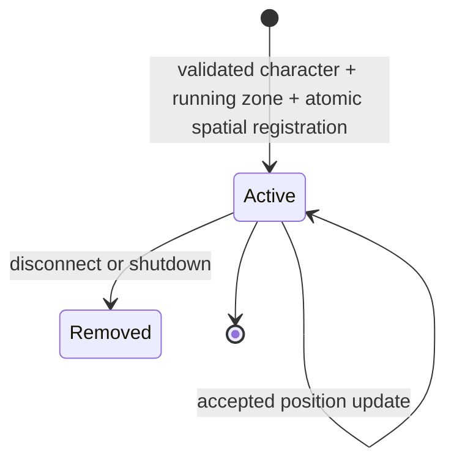

# Entity and Player Lifecycle

## Identity and ownership

The root Node.js zone uses a generated QuadTree node ID as the player's runtime `UniqueID`; it is not the character `_id` or account `_id`. The C# manager preserves that distinction:

| Identity | Type | Scope and use |
|---|---|---|
| Account ID | `AccountId` (`long`) | Persistent account owner; used for authorization and character queries |
| Character ID | `CharacterId` (`long`) | Persistent character `_id`; unique character lookup key |
| Entity ID | `EntityId` (`uint`) | Runtime spatial-node ID allocated by one zone; lookups include the `ZoneId` |
| Zone ID | `ZoneId` (`int`) | Map/zone key |
| Authentication session | `Guid` | Authenticated login session ID, separate from account and character IDs |
| World connection | `Guid` | Network connection association, separate from the login connection |

The source identifies client, NPC, monster, and item-like objects. This implementation registers players only; existing domain definitions for other entity types do not imply that their runtime actors or spawn behavior have been ported.

## Architecture

- `InfiniteSky.Application.Players.PlayerActivationService` validates the login connection's authenticated session, obtains an account-owned character, requires a complete saved location, and resolves a running zone.
- `InfiniteSky.World.Players.PlayerManager` owns active indexes by character, authentication session, world connection, and `(zone, entity)` identity.
- `PlayerRuntime` contains the loaded character, authentication/world connection IDs, zone, runtime `EntityId`, current location, and a small `Active`/`Removed` lifecycle state.
- `ZoneRuntime.TryRegisterSpatialObject` performs spatial insertion and owner publication while holding the same zone lifecycle lock used by shutdown. A failed publication removes the inserted spatial object.
- `PlayerMetrics` records active-count deltas and activation/save failures without character-document or credential data.

## Lifecycle guarantees

- Activation rejects an already-active character, authentication session, or world connection.
- No partially loaded character is published. Database work happens before manager registration and without the manager lock.
- Zone state is checked again inside the atomic registration operation; a stopped zone cannot accept a new player.
- Spatial position is updated before the runtime snapshot. The spatial index rolls back out-of-bounds updates, leaving the runtime position unchanged.
- Removal deletes spatial and manager entries and marks the runtime removed. Repeated disconnect is a no-op; shutdown removes all remaining players.
- Zone shutdown and manager shutdown are ordered by Generic Host registration. Network ingress stops first, player snapshots are saved/removed next, then world and zones stop.
- No per-player background task or world tick callback is created.

## Source behavior and scope

The original `zone.js` adds a `client` spatial node with character level as its size, stores the returned zone-local node ID in `CharacterState.UniqueID`, and removes that node on disconnect. The C# player index follows those source-supported parts. The original source also has an ineffective `Clients.slice(...)` cleanup; the C# manager does not preserve that stale-list defect.

Movement simulation, collision, combat, NPC AI, monsters, loot, respawn, and network state replication are not implemented. Position updates here are an infrastructure API; no client movement packet calls it yet. The runtime does not assign derived HP/Chi maxima, random facing, or a fallback spawn point.

## Tests and limitations

`ZoneManagementTests` exercises identity separation, zone-local registration, nearby-player lookup, accepted/rejected position updates, duplicate activation, spatial rollback, repeated removal, and concurrent duplicate activation. Host and application tests cover account ownership, session expiration during asynchronous load, disconnect persistence, shutdown cleanup, and host order.

These are in-process unit/integration tests. They do not prove original-client entity visibility, a real network disconnect path, or client-visible runtime ID compatibility. Those remain blocked on the missing character/world packet flow and packet fixtures.

## References

- [`zone.js`](../../zone.js) — player membership, proximity candidates, and removal.
- [`QuadTree.js`](../../QuadTree.js) — per-zone node ID and spatial registration.
- [`CharacterState.js`](../../generic/CharacterState.js) — legacy runtime state projection.
- [`PlayerManager.cs`](../../src/InfiniteSky.World/Players/PlayerManager.cs) and [`PlayerRuntime.cs`](../../src/InfiniteSky.World/Players/PlayerRuntime.cs) — C# registry/lifecycle.
- [`ZoneRuntime.cs`](../../src/InfiniteSky.World/Zones/ZoneRuntime.cs) — zone-locked spatial lifecycle boundary.
