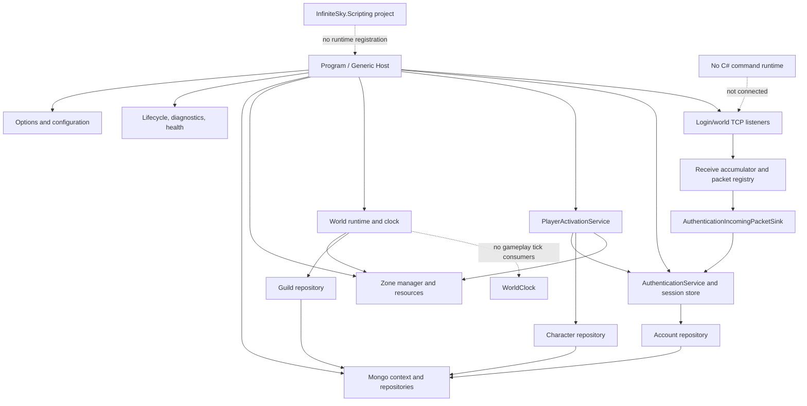

# Full-System Integration Status

## Result

Prompt 20 verified a narrow host-composed, socket-level login workflow and startup rollback behavior. It did **not** make the server a complete MMORPG server: the verified path ends at authenticated account session creation. Character selection, world handshakes, player activation from a client connection, gameplay, scripts, commands, and full Mongo-backed journeys remain unavailable or blocked.

## Runtime composition

[`Program`](../../src/InfiniteSky.Server/Program.cs) delegates to [`ServerApplication`](../../src/InfiniteSky.Server/Hosting/ServerApplication.cs), which builds and runs the one Generic Host from [`ServerHostBuilder`](../../src/InfiniteSky.Server/Hosting/ServerHostBuilder.cs). The composition registers infrastructure/health, Mongo repositories and startup checks, zone manager, world runtime/clock, player activation and shutdown, authentication/session services, and login/world listeners. It validates service construction and scopes when building the provider.

### Startup sequence

Generic Host starts registered hosted services serially because concurrent start is rejected by options validation:

1. Validate options on start; `FoundationHostedService` enters `Initialising` and `Starting`.
2. `MongoPersistenceHostedService` either records database-disabled state or connects, checks the account index, optionally resets account `active`, and starts its health probe.
3. `ZoneManagementHostedService` loads only configured legacy zone IDs/resources.
4. `WorldHostedService` loads guild data when Mongo is enabled, snapshots zone readiness, marks `WorldRuntime` running, then starts the `WorldClock`.
5. `PlayerManagementHostedService` registers its shutdown save boundary; it does not create players.
6. `NetworkHostedService` starts both listeners when networking is enabled.
7. `ApplicationReadinessHostedService` transitions the host lifecycle to `Running`.

The order ensures persistence and world/zone initialization are attempted before listeners bind. However, the current host can start listeners while world/zone readiness is degraded; separate health checks report degradation, and the world listener has no gameplay handlers. Do not interpret listener startup or host lifecycle `Running` as game readiness.

### Shutdown sequence

The Generic Host stops hosted services in reverse order. It withdraws application readiness, stops listeners and closes their connections, invokes player shutdown save/cleanup, stops the world clock/runtime, stops zones, then stops the Mongo probe. Internal player shutdown saves supported location fields, but no client world handler currently activates a player. The Prompt 20 host test verifies a connected login session is removed when the host stops; it does not exercise active-player persistence or a live database.

## Dependency graph and subsystem integration

Protocol framing and packet descriptors are connected to the transport. The login sink handles opcode `0x03`; other registered login descriptors are not implemented handlers. The world registry has fixed-size descriptors, but the sink does not dispatch world gameplay. `PlayerActivationService` has authenticated account ownership checks and zone integration as an internal API, but no world packet calls it or associates a world connection with the login session. Script, plugin, gameplay, and administration projects/services are not connected into executable workflows.

## Integration status by boundary

| Boundary | Prompt 20 result | Evidence / limitation |
|---|---|---|
| Host startup/shutdown | Verified for test configuration | Generic Host integration tests start and stop; empty default zone configuration leaves world readiness degraded. |
| Login TCP → frame → authentication → response → session | Verified with isolated account repository | Host-level test uses real loopback sockets, production framing/sink/auth/session services; MongoDB is substituted. |
| Duplicate login and reconnect | Verified at login/session boundary | Host-level scenario rejects concurrent duplicate account login, releases session on disconnect, and permits reconnect. |
| Partial network startup failure | Verified | Occupied world port causes startup failure; the previously opened login port is released. |
| Mongo-backed login/character persistence | Not verified | Opt-in Mongo tests were skipped; no live or representative production database was used. |
| Character list/selection/world entry | Blocked | No client packet handlers/full wire codec/transfer coordinator. |
| Zone membership/spatial visibility/movement | Not integrated | Zone and spatial components are unit/host tested, not reachable from a client world connection. |
| Gameplay, scripts, commands, moderation | Not integrated | No compatible handlers/runtime/API are registered; source/data/protocol blockers remain. |
| Complete MMORPG client journey | Not ready | No available client transcript can traverse character, world, and gameplay stages. |

## Compatibility and operational limits

- Tests use the original 9-byte receive header, 91-byte login request, and 41-byte login reply layouts. This establishes only the login slice exercised by tests.
- MongoDB tests use Testcontainers only when explicitly opted in. No production database or data was touched.
- Zone loading uses configured IDs and available legacy resources. Missing `.IMG` catalogs and `.WREGION` data prevent claiming complete gameplay/world readiness.
- The networking and database defaults are disabled. Configuration examples are in [`RUNTIME_CONFIGURATION.md`](./RUNTIME_CONFIGURATION.md).
- No original client was run; this work does not claim client compatibility or begin Prompt 21.

Detailed outcomes are listed in [`END_TO_END_TEST_SCENARIOS.md`](./END_TO_END_TEST_SCENARIOS.md); harness scope and commands are in [`INTEGRATION_TEST_HARNESS.md`](./INTEGRATION_TEST_HARNESS.md).
