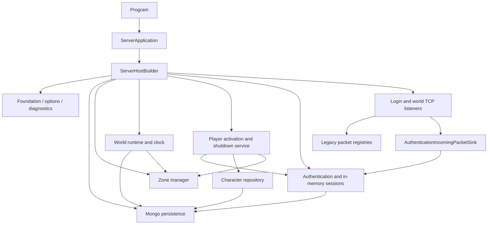

# Prompt 20 Integration Baseline

Baseline captured before Prompt 20 implementation changes on 2026-11-20.

## Repository and validation snapshot

| Item | Baseline |
|---|---|
| Git commit | `073a7cbe7f00df0f752c9c6e9a629f6946cf4f56` (`feat: complete remaining systems and close feature gaps`) |
| Branch / worktree | `master`; clean |
| .NET SDK | `10.0.401` (`global.json` rolls to later 10.0 feature bands) |
| Restore | `dotnet restore InfiniteSky.sln` succeeded; projects were up to date |
| Build | `dotnet build InfiniteSky.sln --no-restore` succeeded; 0 warnings, 0 errors |
| Tests | `dotnet test InfiniteSky.sln --no-build`: 184 passed, 0 failed, 2 opt-in MongoDB tests skipped |
| Formatting | `dotnet format InfiniteSky.sln --verify-no-changes --no-restore` succeeded |
| Direct process run | Not run at baseline; host startup/shutdown and socket behavior are covered by integration tests |

Test results by project: Domain 50/50, Protocol 24/24, GameData 5/5, World 22/22, Server integration 60/60, and Persistence 23 passed with 2 skipped. The skipped tests are the Mongo account and character repository Testcontainers integrations; this run does not verify a live MongoDB server.

## Executable and composition root

The .NET executable is [`Program.cs`](../../src/InfiniteSky.Server/Program.cs), which calls [`ServerApplication.RunAsync`](../../src/InfiniteSky.Server/Hosting/ServerApplication.cs). The single Generic Host composition root is [`ServerHostBuilder.Create`](../../src/InfiniteSky.Server/Hosting/ServerHostBuilder.cs). It binds/validates `InfiniteSkyOptions`, registers the application services and hosted services, and configures DI validation on build.

The actual hosted-service registration/start order is:

1. `FoundationHostedService` — lifecycle/configuration state.
2. `MongoPersistenceHostedService` — startup ping, account index verification and optional active-account reset; disabled by default.
3. `ZoneManagementHostedService` — load configured zone resources.
4. `WorldHostedService` — guild bootstrap, zone-readiness snapshot and 100 ms default clock.
5. `PlayerManagementHostedService` — registers the shutdown save/cleanup boundary.
6. `NetworkHostedService` — starts both login and world listeners when enabled.
7. `ApplicationReadinessHostedService` — publishes the host lifecycle `Running` phase.

Generic Host stop ordering is reversed. Thus readiness is withdrawn before networking stops; networking closes connections before player shutdown saves/removes active players; world and zones stop afterward. Player activation is registered in DI but is not called by a world packet handler. The server references the `InfiniteSky.Scripting` project, but no compatible script runtime or plugin service is registered. No gameplay or administration handlers are wired to the listeners.

The graph shows registered dependencies, not a complete gameplay path. In particular, there is no connection from world packet dispatch to player activation, world entity registration, gameplay, scripts, or commands.

## Runtime configuration and external requirements

- Configuration comes from `appsettings*.json`, command-line/environment providers, and the `INFINITESKY_` environment-variable prefix. Settings bind below `InfiniteSky:*` and are validated on host start.
- `InfiniteSky:Networking:Enabled` defaults to `false`. When enabled, the server binds raw TCP login port `11091` and world port `11092` on `127.0.0.1` by default. Both listeners currently use the nine-byte legacy frame header and their fixed-size registered opcode descriptors.
- `InfiniteSky:Database:Enabled` defaults to `false`. When enabled, MongoDB is required at startup; the configured database defaults to `ts1`, account collection to `account_mongooses`, character collection to `character_mongooses`, and guild collection to `guilds`. Account/character collection naming still requires deployment verification. The C# persistence dependency is `MongoDB.Driver` 3.14.0.
- `InfiniteSky:Zones:Load` defaults to an empty list. Zone data resolves below the host content root's `data` directory. Only explicitly configured legacy catalog IDs are considered.
- The repository contains 56 `.MOB`, 52 `.NPC`, and 42 `.pac` files in the surveyed `data` tree. It contains no `.IMG` game catalogs or `.WREGION` files. Existing spawn files do not mean C# MOB simulation is implemented; the root migration documents keep MOB loading disabled/incomplete.
- The root Node.js project is a separate historical runtime (`main.js`, `package.json`, Mongoose and legacy packages). Prompt 20 did not install or run it.
- Test dependencies include xUnit and `Testcontainers.MongoDb` 4.17.0; the latter's database tests are opt-in. No production service or data was used.

## Baseline behavior and known limitations

With the checked-in defaults, the host lifecycle starts and stops in tests, database and networking are disabled, and the empty zone list keeps world/zone readiness degraded. This is an intentional degraded baseline, not a ready game server. The host can report its lifecycle phase as running while separate world/zone health checks remain degraded.

When networking is enabled, [`NetworkHostedService`](../../src/InfiniteSky.Server/Hosting/NetworkHostedService.cs) constructs both listeners. The login registry includes login, keepalive, character create/delete, and game-start descriptors, but [`AuthenticationIncomingPacketSink`](../../src/InfiniteSky.Server/Authentication/AuthenticationIncomingPacketSink.cs) implements only login opcode `0x03`. The world registry has six proven fixed-size descriptors; the sink does not implement their world behavior. Unknown or registered-but-unhandled packets do not create a character/world workflow.

The following workflows are not connected end-to-end:

- Account login to character list, selection, and full Character BSON/wire mapping.
- Authenticated login to world handshake, transfer, player activation, spawn, zone membership, and client notifications.
- Movement to spatial visibility and outbound world packets.
- Gameplay calculations to handlers, persistence, or protocol responses.
- Script/plugin lifecycle and event dispatch.
- Chat, GM command execution/authorization, and command responses.
- Full character/inventory persistence and live Mongo compatibility.

The original Node.js entry point loads configuration, creates Mongo access, loads game information and scripts, and starts the root login/world components. The original world component starts zone loading and emits `ready` only after zone loading drains; the root then starts its game-step loop. The C# service ordering is documented above, but its `WorldClock` is only a clock and does not execute the legacy gameplay step handlers.

## Existing integration evidence and runtime failures

- `FoundationHostTests` starts/stops the composed host, checks the hosted-service ordering and degraded world readiness, and verifies invalid configuration is rejected.
- `FoundationHostTests.UnreachableMongoDatabaseFailsStartupAndIsNotReportedHealthy` verifies an enabled but unreachable MongoDB causes startup failure and unhealthy database health; this is expected behavior, not an unexplained baseline failure.
- `NetworkingTests` uses real loopback TCP for framing, response writes, connection limits and remote disconnect, but constructs the listener directly.
- `AuthenticationTests.LoginPacketUsesLegacyResponseAndCleansSessionOnDisconnect` uses a real loopback socket and the production packet sink/authentication service with a test account repository, but does not start the complete Generic Host.
- No baseline test executes a client character-selection/world-entry/gameplay journey. No original-client session or live-database compatibility is claimed.

There were no restore, build, format, or runnable test failures in the baseline. The primary integration failure is missing functionality rather than a reproduced defect: clients cannot progress from login into an active world player. Detailed scenario outcomes and Prompt 20 changes are tracked in [`END_TO_END_TEST_SCENARIOS.md`](./END_TO_END_TEST_SCENARIOS.md) and [`INTEGRATION_FAILURES_AND_FIXES.md`](./INTEGRATION_FAILURES_AND_FIXES.md).
