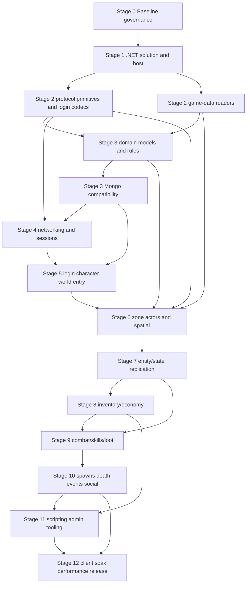

# InfiniteSky .NET 10 Migration Execution Plan

## Governance gate

This plan does not authorize implementation. Each stage starts only after explicit approval and completes only when the matrix features have test evidence sufficient for their status transition.

## Dependency graph

## Stage 0 — Governance and evidence baseline

**Features:** all matrix inventory, `INT-007`, `INT-015`.

**Work:**

- obtain approval for matrix and architecture;
- freeze protocol/data fixtures and representative BSON corpus;
- record all exclusions/deviations;
- define status evidence template.

**Dependencies:** none.

**Exit criteria:** every source feature maps to an ID; unknown/block reasons documented; owner/approval recorded.

## Stage 1 — Solution skeleton, host, and operations

**Features:** `INF-001..016`, partial `INT-014..015`.

**Work:**

- create approved solution/project boundaries;
- host/options/diagnostics/readiness/shutdown;
- build/release scripts and clean-machine configuration;
- architecture dependency tests.

**Dependencies:** Stage 0.

**Exit criteria:** host starts in a fixture/no-listener mode, validates config, reports readiness state, and shuts down cleanly.

## Stage 2 — Protocol and original game-data foundations

**Features:** `PRO-001..004`, `PRO-033`, `DAT-001..011`, `INT-007`.

**Work:**

- codec primitives and frame parser;
- `.IMG`, `.NPC`, `.MOB`, `.WREGION`, CSV readers;
- fixture/capture classification;
- unknown-byte retention.

**Dependencies:** Stage 1.

**Exit criteria:** binary readers reject invalid lengths, all classified fixtures pass, and known fields round-trip. Block `PRO-015/017/032` unknowns remain visible.

## Stage 3 — Domain and MongoDB compatibility

**Features:** `DOM-001..015`, `PER-001..012`, `DAT-010`.

**Work:**

- domain IDs/aggregates/value types;
- start/stat/progression models;
- BSON documents/mappers/repositories;
- save queue;
- compatibility validator/dry-run.

**Dependencies:** Stage 2 schemas/readers.

**Exit criteria:** legacy BSON fixtures round-trip, stats/progression fixtures pass, counters are concurrency-safe, and no field loss is reported for known data.

## Stage 4 — TCP networking and session transfer

**Features:** `NET-001..010`, `PRO-005..014`, `PRO-018` parser skeleton.

**Work:**

- pipeline listener/connections;
- ordered writer/backpressure;
- phase state;
- address selection;
- transfer/duplicate session store;
- login/world greeting codecs.

**Dependencies:** Stages 2-3.

**Exit criteria:** fragmented/coalesced frames and both connection types pass; transfer expires and consumes exactly once.

## Stage 5 — Login, character management, and world entry

**Features:** `PRO-006..017`, `GP-001..003`, `PER-007..008`, `INT-001`.

**Work:**

- account login and duplicate policy;
- character list/create/delete/start;
- world handshake/auth;
- 0x16 and 0x17 encoding;
- storage/bank initialization;
- loopback end-to-end client transcript.

**Dependencies:** Stage 4.

**Exit criteria:** an original-protocol client authenticates, manages/selects characters, receives endpoint, enters world, and receives character/world data byte-compatible.

## Prompt 13 — Single-world lifecycle and bootstrap foundation

**Features:** `WLD-011..013`.

**Work completed:** single root-world lifecycle/readiness, 100 ms default cadence configuration and a cancellation-aware clock boundary, asynchronous MongoDB guild bootstrap, health/metrics, and a zone-readiness interface with no placeholder zone implementation.

**Evidence:** `WorldRuntimeTests`, `WorldClockTests`, `MongoGuildDocumentMapperTests`, and server host integration tests. These establish implementation and host behavior, not live-database or original-client parity; the matrix status remains `IMPLEMENTED`.

**Stage 5 exit limitations (before Prompt 14):** no source-backed world ID or world registry; no zone provider, world packet/session entry, player, or gameplay behavior. Prompt 14 supplies the zone provider; world readiness still depends on guild data and configured zones.

## Stage 6 — Zone actors, persistence snapshots, and spatial index (Prompt 14 foundation complete)

**Features:** `WLD-001..010`, `ZON-001..010`, selected `PER-012`.

**Prompt 14 work completed:**

- source catalog and configured zone loading;
- NPC/WREGION record readers;
- lock-protected X/Z QuadTree and radius candidate queries;
- zone lifecycle, registry, host ordering, readiness, health, and owned-resource shutdown.

See the Prompt 14 zone management and spatial implementation report for evidence. Implemented matrix rows remain `IMPLEMENTED`, not `VERIFIED`.

**Validation:** `dotnet restore` succeeded, the complete solution build completed with zero warnings/errors, all 144 runnable tests passed (one opt-in MongoDB test skipped), and `dotnet format --verify-no-changes --no-restore` passed.

**Remaining stage work:**

- zone actor/mailbox and actor-owned mutable entities;
- portal resolution and transfer integration;
- player/NPC/item/monster membership and entity bootstrap;
- visibility output, timers, persistence snapshots, movement, terrain, and simulation.

**Dependencies:** Stage 5 and `DAT-007..008`.

Prompt 13 supplied only the world lifecycle boundary. Prompt 14 supplied the static zone-management/spatial foundation. Prompt 15 is approved and its internal player/entity infrastructure is documented below; network world entry and the remaining actor simulation are still incomplete.

**Exit criteria:** zones load, clients transfer, radius queries are deterministic, no actor blocks on Mongo, and graceful shutdown drains state.

## Prompt 15 — Player and entity infrastructure

**Features:** `ENT-009..021`, partial `PER-003`, `GP-002`, and `GP-003` boundaries.

**Implemented:** account/server-scoped character loading; supported-field raw BSON mapping; targeted saved-location persistence; session-verified character activation; separate persistent and zone-local IDs; duplicate-safe player registry; atomic spatial registration/update/removal; nearby-player candidates; disconnect/shutdown location saves; and host/zone cleanup ordering.

**Evidence:** focused mapper, player-manager, activation, shutdown-order, DI, and optional MongoDB container tests. The full character document and client protocol are not verified; `ENT-020` and `ENT-021` remain `BLOCKED`, and `PER-003` remains `IN_PROGRESS`.

**Known blockers:** no full Character wire codec or source packet fixture, no .NET derived-stat calculator, no representative production BSON, no client character/world packet handler, and no real network disconnect-to-player cleanup wiring. Do not invent fallback locations or spawn/gameplay state.

**Validation record:** `dotnet restore InfiniteSky.sln` succeeded; full solution build passed with zero warnings/errors; 156 tests passed and two opt-in MongoDB tests were skipped; full solution format verification passed. Docker is unavailable, so no live MongoDB result is claimed.

## Stage 7 — Entities, players, movement, and state replication

**Features:** `ENT-001..008`, `GP-007..008`, `INT-002`.

**Work:**

- protocol-connected player actor/state replication and client-visible IDs;
- NPC/monster/item runtime actors and target resolution;
- derived state projectors and HP/Chi/gameplay updates;
- legacy movement and area notification packets;
- network disconnect/transfer integration beyond Prompt 15's internal cleanup boundary;
- corrected movement behind profile.

**Dependencies:** Stage 6 and action/entity codecs.

**Exit criteria:** two controlled clients observe consistent entity/movement state and reconnect/disconnect ownership is correct.

## Stage 8 — Inventory, equipment, economy, and commerce foundations

**Features:** `PRO-023`, `GP-005..006`, `GP-017..021`, `GP-033..034`, `INT-003`.

**Work:**

- all implemented item-action codes;
- storage/bank/silver;
- consume/equip/unequip;
- NPC sales and commerce;
- transformation/economy transactions.

**Dependencies:** Stage 7 and persistence.

**Exit criteria:** reconnect proves item/silver conservation across each supported operation and malformed requests cannot create/lose quantities.

## Stage 9 — Combat, skills, buffs, loot, and XP

**Features:** `PRO-018..019`, `PRO-024..025`, `GP-004`, `GP-009..016`, `GP-022`, `INT-004`.

**Work:**

- legacy and corrected damage profiles;
- attack routing and HP;
- skill learning/use/bar/buffs;
- deterministic loot and XP;
- attacker/threat data;
- packet/state results.

**Dependencies:** Stages 7-8.

**Exit criteria:** deterministic transcripts cover PvP/PvM, level-up, skill, buff, and drops; double subtraction and profile differences are explicitly tested.

## Stage 10 — Spawning, death, social systems, and events

**Features:** `GP-023..032`, `GP-035..038`, `PRO-020..031`, `INT-005`.

**Work:**

- monster spawn/respawn;
- player death/return;
- party/friends/chat/trade/duel/guild;
- Nangi/gambler/ticket/clear-fog;
- NPC interaction;
- quest only when evidence satisfies blockers.

**Dependencies:** Stages 6-9.

**Exit criteria:** actor/time/social disconnect tests pass; quests remain blocked with an explicit source gap if evidence does not arrive.

## Stage 11 — Scripting, administration, editors, and operations

**Features:** `SCR-001..008`, `ADM-001..013`, `INT-011..014`.

**Work:**

- C# command ports;
- isolated script/plugin capability;
- restricted CLI;
- editor/spawn tooling decisions;
- deployment/runbooks;
- audit/redaction.

**Dependencies:** all services commands call.

**Exit criteria:** every tracked command/module is ported, isolated, or approved `NOT_APPLICABLE`; production tools have bounded privileges.

## Stage 12 — Compatibility soak, performance, and release candidate

**Features:** `INT-006`, `INT-008..010`, all P0/P1 residuals.

**Work:**

- representative BSON shadow comparison;
- raw client soak;
- concurrency/load;
- tick/network/save budgets;
- restart/reconnect;
- deployment rehearsal and rollback.

**Dependencies:** all P0 and release-selected P1 features.

**Exit criteria:**

- every P0 is `VERIFIED`;
- every P1 is verified or has an approved deferral;
- no unknown packet on required client journey;
- migration dry-run passes;
- soak and performance criteria are met.

## Measurable cross-cutting acceptance criteria

| Category | Metric/criterion |
|---|---|
| Packet coverage | 100% active registered opcodes in registry; 100% P0 fixture byte match |
| Frame handling | Pass fragmentation 1-byte reads, coalescing, overflow, truncation, and max-size cases |
| DB round trip | 0 unexplained loss for selected known BSON fields; per-server bank, counters, guild members preserved |
| Persistence | 100% acknowledged critical inventory/economy operations survive reconnect/restart |
| Gameplay determinism | Same seed/profile/time produces identical combat, loot, buff, and spawn result |
| Zone isolation | No shared mutable entity across actors; no deadlock under transfer/load test |
| World cadence | Tick cadence and p95 duration remain within approved configured budget |
| Client journey | Authenticate → create/select → enter world → see/move/interact → inventory → combat → zone transfer → reconnect |
| Diagnostics | Correlation IDs; no password/PIN/raw credential in normal logs |
| Release | All P0 VERIFIED; selected P1 verified or explicitly approved; no unresolved P0 blocker |

## Status transition policy

- `NOT_STARTED` → `IN_PROGRESS`: owner, dependencies, and tests defined.
- `IN_PROGRESS` → `IMPLEMENTED`: required production paths and documentation exist.
- `IMPLEMENTED` → `VERIFIED`: tests and acceptance evidence are linked.
- Any feature → `BLOCKED`: concrete unresolved dependency; blocker and owner recorded.
- Any feature → `NOT_APPLICABLE`: approved architecture deviation and removal/alternative rationale; never used to hide unfinished work.
