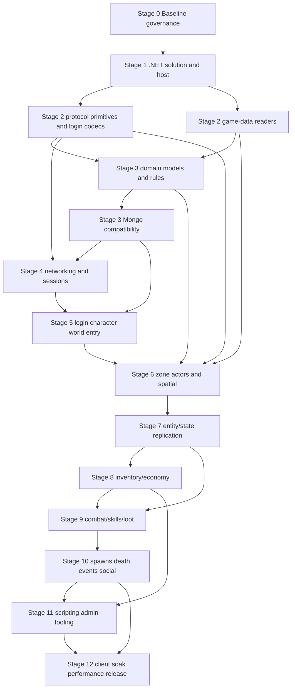

# InfiniteSky .NET 10 Migration Execution Plan

## Governance gate

This plan does not authorize implementation. Each stage starts only after explicit approval and completes only when the matrix features have test evidence sufficient for their status transition.

## Dependency graph

## Stage 0 — Governance and evidence baseline

**Features:** all matrix inventory, `INT-007`, `INT-015`.

**Work:**

- obtain approval for matrix and architecture;
- freeze protocol/data fixtures and representative BSON corpus;
- record all exclusions/deviations;
- define status evidence template.

**Dependencies:** none.

**Exit criteria:** every source feature maps to an ID; unknown/block reasons documented; owner/approval recorded.

## Stage 1 — Solution skeleton, host, and operations

**Features:** `INF-001..016`, partial `INT-014..015`.

**Work:**

- create approved solution/project boundaries;
- host/options/diagnostics/readiness/shutdown;
- build/release scripts and clean-machine configuration;
- architecture dependency tests.

**Dependencies:** Stage 0.

**Exit criteria:** host starts in a fixture/no-listener mode, validates config, reports readiness state, and shuts down cleanly.

## Stage 2 — Protocol and original game-data foundations

**Features:** `PRO-001..004`, `PRO-033`, `DAT-001..011`, `INT-007`.

**Work:**

- codec primitives and frame parser;
- `.IMG`, `.NPC`, `.MOB`, `.WREGION`, CSV readers;
- fixture/capture classification;
- unknown-byte retention.

**Dependencies:** Stage 1.

**Exit criteria:** binary readers reject invalid lengths, all classified fixtures pass, and known fields round-trip. Block `PRO-015/017/032` unknowns remain visible.

## Stage 3 — Domain and MongoDB compatibility

**Features:** `DOM-001..015`, `PER-001..012`, `DAT-010`.

**Work:**

- domain IDs/aggregates/value types;
- start/stat/progression models;
- BSON documents/mappers/repositories;
- save queue;
- compatibility validator/dry-run.

**Dependencies:** Stage 2 schemas/readers.

**Exit criteria:** legacy BSON fixtures round-trip, stats/progression fixtures pass, counters are concurrency-safe, and no field loss is reported for known data.

## Stage 4 — TCP networking and session transfer

**Features:** `NET-001..010`, `PRO-005..014`, `PRO-018` parser skeleton.

**Work:**

- pipeline listener/connections;
- ordered writer/backpressure;
- phase state;
- address selection;
- transfer/duplicate session store;
- login/world greeting codecs.

**Dependencies:** Stages 2-3.

**Exit criteria:** fragmented/coalesced frames and both connection types pass; transfer expires and consumes exactly once.

## Stage 5 — Login, character management, and world entry

**Features:** `PRO-006..017`, `GP-001..003`, `PER-007..008`, `INT-001`.

**Work:**

- account login and duplicate policy;
- character list/create/delete/start;
- world handshake/auth;
- 0x16 and 0x17 encoding;
- storage/bank initialization;
- loopback end-to-end client transcript.

**Dependencies:** Stage 4.

**Exit criteria:** an original-protocol client authenticates, manages/selects characters, receives endpoint, enters world, and receives character/world data byte-compatible.

## Prompt 13 — Single-world lifecycle and bootstrap foundation

**Features:** `WLD-011..013`.

**Work completed:** single root-world lifecycle/readiness, 100 ms default cadence configuration and a cancellation-aware clock boundary, asynchronous MongoDB guild bootstrap, health/metrics, and a zone-readiness interface with no placeholder zone implementation.

**Evidence:** `WorldRuntimeTests`, `WorldClockTests`, `MongoGuildDocumentMapperTests`, and server host integration tests. These establish implementation and host behavior, not live-database or original-client parity; the matrix status remains `IMPLEMENTED`.

**Stage 5 exit limitations (before Prompt 14):** no source-backed world ID or world registry; no zone provider, world packet/session entry, player, or gameplay behavior. Prompt 14 supplies the zone provider; world readiness still depends on guild data and configured zones.

## Stage 6 — Zone actors, persistence snapshots, and spatial index (Prompt 14 foundation complete)

**Features:** `WLD-001..010`, `ZON-001..010`, selected `PER-012`.

**Prompt 14 work completed:**

- source catalog and configured zone loading;
- NPC/WREGION record readers;
- lock-protected X/Z QuadTree and radius candidate queries;
- zone lifecycle, registry, host ordering, readiness, health, and owned-resource shutdown.

See the Prompt 14 zone management and spatial implementation report for evidence. Implemented matrix rows remain `IMPLEMENTED`, not `VERIFIED`.

**Validation:** `dotnet restore` succeeded, the complete solution build completed with zero warnings/errors, all 144 runnable tests passed (one opt-in MongoDB test skipped), and `dotnet format --verify-no-changes --no-restore` passed.

**Remaining stage work:**

- zone actor/mailbox and actor-owned mutable entities;
- portal resolution and transfer integration;
- player/NPC/item/monster membership and entity bootstrap;
- visibility output, timers, persistence snapshots, movement, terrain, and simulation.

**Dependencies:** Stage 5 and `DAT-007..008`.

Prompt 13 supplied only the world lifecycle boundary. Prompt 14 supplied the static zone-management/spatial foundation. Prompt 15 is approved and its internal player/entity infrastructure is documented below; network world entry and the remaining actor simulation are still incomplete.

**Exit criteria:** zones load, clients transfer, radius queries are deterministic, no actor blocks on Mongo, and graceful shutdown drains state.

## Prompt 15 — Player and entity infrastructure

**Features:** `ENT-009..021`, partial `PER-003`, `GP-002`, and `GP-003` boundaries.

**Implemented:** account/server-scoped character loading; supported-field raw BSON mapping; targeted saved-location persistence; session-verified character activation; separate persistent and zone-local IDs; duplicate-safe player registry; atomic spatial registration/update/removal; nearby-player candidates; disconnect/shutdown location saves; and host/zone cleanup ordering.

**Evidence:** focused mapper, player-manager, activation, shutdown-order, DI, and optional MongoDB container tests. The full character document and client protocol are not verified; `ENT-020` and `ENT-021` remain `BLOCKED`, and `PER-003` remains `IN_PROGRESS`.

**Known blockers:** no full Character wire codec or source packet fixture, no .NET derived-stat calculator, no representative production BSON, no client character/world packet handler, and no real network disconnect-to-player cleanup wiring. Do not invent fallback locations or spawn/gameplay state.

**Validation record:** `dotnet restore InfiniteSky.sln` succeeded; full solution build passed with zero warnings/errors; 156 tests passed and two opt-in MongoDB tests were skipped; full solution format verification passed. Docker is unavailable, so no live MongoDB result is claimed.

## Stage 7 — Entities, players, movement, and state replication

**Features:** `ENT-001..008`, `GP-007..008`, `INT-002`.

**Work:**

- protocol-connected player actor/state replication and client-visible IDs;
- NPC/monster/item runtime actors and target resolution;
- derived state projectors and HP/Chi/gameplay updates;
- legacy movement and area notification packets;
- network disconnect/transfer integration beyond Prompt 15's internal cleanup boundary;
- corrected movement behind profile.

**Dependencies:** Stage 6 and action/entity codecs.

**Exit criteria:** two controlled clients observe consistent entity/movement state and reconnect/disconnect ownership is correct.

## Stage 8 — Inventory, equipment, economy, and commerce foundations

**Features:** `PRO-023`, `GP-005..006`, `GP-017..021`, `GP-033..034`, `INT-003`.

**Work:**

- all implemented item-action codes;
- storage/bank/silver;
- consume/equip/unequip;
- NPC sales and commerce;
- transformation/economy transactions.

**Dependencies:** Stage 7 and persistence.

**Exit criteria:** reconnect proves item/silver conservation across each supported operation and malformed requests cannot create/lose quantities.

## Stage 9 — Combat, skills, buffs, loot, and XP

**Features:** `PRO-018..019`, `PRO-024..025`, `GP-004`, `GP-009..016`, `GP-022`, `INT-004`.

**Work:**

- legacy and corrected damage profiles;
- attack routing and HP;
- skill learning/use/bar/buffs;
- deterministic loot and XP;
- attacker/threat data;
- packet/state results.

**Dependencies:** Stages 7-8.

**Exit criteria:** deterministic transcripts cover PvP/PvM, level-up, skill, buff, and drops; double subtraction and profile differences are explicitly tested.

**Prompt 16 status:** the source audit and per-feature implementation plan are recorded in [GAMEPLAY_IMPLEMENTATION_PLAN.md](GAMEPLAY_IMPLEMENTATION_PLAN.md). `GP-004` has an isolated C# XP/level/point calculation and `GP-005` has isolated stat-allocation arithmetic, both with synthetic unit tests only. The `005_00001.IMG` data, derived recalculation, vitals, packet and persistence boundaries are still missing. No combat, skill, item, movement, NPC/monster, quest, social, or economy behavior is claimed migrated. Restore and format verification passed, the solution build has zero warnings/errors, and the full test suite reports 178 passed/2 skipped. Keep remaining Stage 7-10 work in dependency order; do not begin Prompt 17.

## Stage 10 — Spawning, death, social systems, and events

**Features:** `GP-023..032`, `GP-035..038`, `PRO-020..031`, `INT-005`.

**Work:**

- monster spawn/respawn;
- player death/return;
- party/friends/chat/trade/duel/guild;
- Nangi/gambler/ticket/clear-fog;
- NPC interaction;
- quest only when evidence satisfies blockers.

**Dependencies:** Stages 6-9.

**Exit criteria:** actor/time/social disconnect tests pass; quests remain blocked with an explicit source gap if evidence does not arrive.

## Stage 11 — Scripting, administration, editors, and operations

**Features:** `SCR-001..013`, `ADM-001..013`, `INT-011..014`.

**Work:**

- native C# migration of source-verified server behavior;
- source-backed event/script boundary only where a real migrated consumer requires it;
- explicit disposition of the legacy VMScript and FruitSalad alternate runtime;
- restricted CLI;
- editor/spawn tooling decisions;
- deployment/runbooks;
- audit/redaction.

**Dependencies:** all services commands call.

**Exit criteria:** every tracked command/module is ported, isolated, or approved `NOT_APPLICABLE`; production tools have bounded privileges.

**Prompt 17 outcome:** the root audit found shared-process VMScript execution, live global service dependencies, active packet/command module loaders, and filename-based built-in plugin startup; it did not find a conventional plugin API or a tracked root external plugin set. `InfiniteSky.Scripting` has no runtime implementation or JavaScript dependency. Native C# migration is selected for server-owned behavior, but the current source/API dependencies block a compatible scripting runtime. No generic extension host or embedded JavaScript engine was added. See the Prompt 17 documents and `MIGRATION_STATUS.md`; `SCR-001..013` remain individually tracked and no script is claimed migrated.

**Prompt 18 outcome:** the source-backed root chat/CLI and FruitSalad command inventories are documented in `ADMIN_COMMAND_COMPATIBILITY_MATRIX.md`. No C# command infrastructure or handlers were added because world chat opcodes were not dispatched, the Prompt 18 session lacked the source account `Level`, and command effects required missing gameplay/persistence boundaries. `ADM-001..013` and `GP-032` were `BLOCKED`, not implemented or verified. Prompt 19 closes only the account-level session field; the other command blockers remain. The command inventory distinguishes active behavior, test utilities, partial handlers, stubs, disabled entries, and absent moderation features. See the Prompt 18 administration documents and `MIGRATION_STATUS.md`; original Node.js source remains unchanged.

**Prompt 19 outcome:** the source-to-target coverage audit and all 169 open matrix IDs are indexed in `REMAINING_FEATURE_GAPS.md`; `FEATURE_GAP_CLOSURE_PLAN.md` orders the concrete dependency gates. The feasible account-authority gap was closed narrowly: account BSON `Level` is projected, validated/mapped and carried in `AuthenticatedSession`. No world/chat/gameplay/command integration or guessed protocol/data behavior was added. The solution is not ready for Prompt 20 because character/world packet flow, representative data/BSON, transfer, gameplay, and client journey remain incomplete. See `FEATURE_COMPLETENESS_REPORT.md`, `REMAINING_BLOCKERS.md`, and `INTEGRATION_READINESS.md`; no Prompt 20 work has started.

**Prompt 20 outcome:** baseline was captured at `073a7cbe7f00df0f752c9c6e9a629f6946cf4f56` with a clean worktree, successful restore/build/format, and 184 passing tests plus 2 skipped opt-in Mongo tests. Added a Generic Host + real loopback TCP login integration test using test persistence; it verifies success response, duplicate-account rejection, disconnect cleanup, reconnect, shutdown cleanup, and a separate partial-listener-start rollback test. No production runtime code, original Node.js source, or production data changed. Matrix items `INT-001`, `INT-010`, and `INT-015` are now `IN_PROGRESS`; character/world/gameplay/script/admin workflows, live MongoDB integration, and original-client compatibility remain blocked or unstarted. See `INTEGRATION_BASELINE.md`, `FULL_SYSTEM_INTEGRATION.md`, `END_TO_END_TEST_SCENARIOS.md`, `INTEGRATION_TEST_HARNESS.md`, `INTEGRATION_FAILURES_AND_FIXES.md`, and `RUNTIME_CONFIGURATION.md`. The server is not ready for original-client testing; Prompt 21 has not started.

**Prompt 21 outcome:** no original game client executable/build or client-attributable capture was available. Repository inspection found TSX helper/launcher source only. The original Node server was not run because legacy dependencies, isolated configuration/test script, and local MongoDB were unavailable. Source comparison found and fixed the missing 21-byte login greeting using the existing Node-derived fixture; loopback tests verify greeting-before-request ordering and exact bytes. This does not verify original-client compatibility. Character/world, gameplay, and client configuration remain blocked; `INT-008` is now `BLOCKED`, and no client row is `VERIFIED`. See `ORIGINAL_CLIENT_TEST_ENVIRONMENT.md`, `ORIGINAL_CLIENT_COMPATIBILITY_MATRIX.md`, `CLIENT_PROTOCOL_CAPTURES.md`, `CLIENT_PACKET_FIXTURES.md`, `CLIENT_COMPATIBILITY_ISSUES.md`, `CLIENT_COMPATIBILITY_TEST_RESULTS.md`, and `CLIENT_COMPATIBILITY_READINESS.md`. Prompt 22 was subsequently approved and is recorded below; do not begin Prompt 23 without explicit approval.

## Stage 12 — Compatibility soak, performance, and release candidate

**Features:** `INT-006`, `INT-008..010`, all P0/P1 residuals.

**Work:**

- representative BSON shadow comparison;
- raw client soak;
- concurrency/load;
- tick/network/save budgets;
- restart/reconnect;
- deployment rehearsal and rollback.

**Dependencies:** all P0 and release-selected P1 features.

**Exit criteria:**

- every P0 is `VERIFIED`;
- every P1 is verified or has an approved deferral;
- no unknown packet on required client journey;
- migration dry-run passes;
- soak and performance criteria are met.

## Measurable cross-cutting acceptance criteria

| Category | Metric/criterion |
|---|---|
| Packet coverage | 100% active registered opcodes in registry; 100% P0 fixture byte match |
| Frame handling | Pass fragmentation 1-byte reads, coalescing, overflow, truncation, and max-size cases |
| DB round trip | 0 unexplained loss for selected known BSON fields; per-server bank, counters, guild members preserved |
| Persistence | 100% acknowledged critical inventory/economy operations survive reconnect/restart |
| Gameplay determinism | Same seed/profile/time produces identical combat, loot, buff, and spawn result |
| Zone isolation | No shared mutable entity across actors; no deadlock under transfer/load test |
| World cadence | Tick cadence and p95 duration remain within approved configured budget |
| Client journey | Authenticate → create/select → enter world → see/move/interact → inventory → combat → zone transfer → reconnect |
| Diagnostics | Correlation IDs; no password/PIN/raw credential in normal logs |
| Release | All P0 VERIFIED; selected P1 verified or explicitly approved; no unresolved P0 blocker |

## Status transition policy

- `NOT_STARTED` → `IN_PROGRESS`: owner, dependencies, and tests defined.
- `IN_PROGRESS` → `IMPLEMENTED`: required production paths and documentation exist.
- `IMPLEMENTED` → `VERIFIED`: tests and acceptance evidence are linked.
- Any feature → `BLOCKED`: concrete unresolved dependency; blocker and owner recorded.
- Any feature → `NOT_APPLICABLE`: approved architecture deviation and removal/alternative rationale; never used to hide unfinished work.

## Prompt 22 — regression and parity verification complete

The pre-change baseline was captured at `c631b4514828b9a98a6f390118e029d491d44fd7`. Restore/build succeeded; the baseline suite reported 186 passed, 0 failed and 2 skipped opt-in MongoDB tests. The final suite after Prompt 22's source-derived world-handshake fixture test reported 187 passed, 0 failed and 2 skipped. The final full solution build had 0 warnings/errors; formatting verification and `git diff --check` passed.

Prompt 22 created the baseline, test inventory, parity coverage, comprehensive regression, issues/fixes, execution guide and readiness reports under `docs/migration/`. Coverage collector output was captured and explicitly treated as line/branch execution coverage, not parity proof. Three repeat runs of the pre-addition baseline produced the same totals without observed failures. The 14 existing `VERIFIED` feature statuses were not expanded; no feature was promoted based only on mocked tests or compilation.

The world-handshake request structure now has an 18-byte fixture derived from `packets/world/handshake.js`. The raw `0x15` success response, remaining world/login functionality, live MongoDB integration, differential Node execution and original-client verification remain unavailable or blocked. The feature matrix totals remain 137 `NOT_STARTED`, 7 `IN_PROGRESS`, 48 `IMPLEMENTED`, 14 `VERIFIED`, 25 `BLOCKED`, and 1 `NOT_APPLICABLE` (232).

**Prompt 22 gate:** Prompt 22 is complete. Prompt 23 was subsequently approved and is recorded below.

## Prompt 23 — Performance, scalability, and load testing

Prompt 23 is in progress with its scope limited by implemented behavior. It establishes a Windows/.NET 10 baseline and a source-compatible real-socket login/authentication harness. The tested session ceiling is the configured 100 concurrent connections; it is not an active-player or production capacity claim.

Evidence and reproducible commands:

- [Performance baseline](PERFORMANCE_BASELINE.md)
- [Performance test plan](PERFORMANCE_TEST_PLAN.md)
- [Benchmark results](PERFORMANCE_BENCHMARK_RESULTS.md)
- [Optimization decisions](PERFORMANCE_OPTIMIZATIONS.md)
- [Scalability limits](SCALABILITY_LIMITS.md)

The duplicate receive/send loop starts in `NetworkConnection.StartAsync` were corrected after an ordered-frame test failed before the change and passed afterward. Measurements did not establish a consistent performance improvement, and no unrelated speculative optimization was made. Full world/gameplay, live MongoDB, original-client, Node differential, long-soak, and overload workloads remain blocked or untested.

**Stop gate:** Prompt 24 was subsequently approved and is recorded below. Do not begin Prompt 25 release preparation without explicit approval. Do not mark the server-wide performance budget verified until representative implemented world/gameplay workloads and their measured evidence exist.

## Prompt 24 — Security, reliability, and production hardening

Prompt 24 captured a clean pre-change baseline at commit `4159f887517fbb34145adfa92651b6d07a24c733`: restore/build succeeded, the build had 0 warnings/errors, and the full suite reported 188 passed with 2 opt-in MongoDB integration tests skipped. NuGet vulnerability/deprecation/outdated-package audits and a bounded secret-pattern scan are recorded in [SECURITY_HARDENING_BASELINE.md](SECURITY_HARDENING_BASELINE.md).

The bounded static review and conditional findings are in [THREAT_MODEL.md](THREAT_MODEL.md) and [SECURITY_FINDINGS.md](SECURITY_FINDINGS.md). It confirmed that raw legacy TCP login is unencrypted and the legacy account password field remains plaintext. These cannot be safely changed without client and account migration evidence. MongoDB TLS, online guessing controls, and multi-instance session ownership remain conditional/unverified. Administrative, scripting, world-character, and gameplay network handlers remain blocked/absent; absence is not marked secure.

No runtime or dependency upgrade was made because the confirmed issues require compatibility/deployment decisions and no live configuration was available. Operational procedures and residual risks are documented in [OPERATIONAL_RECOVERY.md](OPERATIONAL_RECOVERY.md) and [RESIDUAL_SECURITY_RISKS.md](RESIDUAL_SECURITY_RISKS.md); [PRODUCTION_HARDENING_CHECKLIST.md](PRODUCTION_HARDENING_CHECKLIST.md) explicitly records incomplete evidence. No security area was promoted to `VERIFIED` from static inspection.

**Stop gate:** The .NET server is not ready for final release preparation or public deployment. Do not begin Prompt 25 or publish a release without explicit approval and resolution or formal acceptance of the documented release-blocking risks.

## Prompt 25 — final release preparation and migration completion

Prompt 25 was explicitly approved. The baseline, final gap audit, feature reconciliation, acceptance criteria/report, migration report, handover, operator/developer docs, and local candidate manifest are recorded under `docs/migration/` and `docs/`. The feature matrix retains its evidence-derived counts; no feature was promoted to `VERIFIED` merely because this is the last stage.

The solution is set to restore from checked-in NuGet lockfiles; CI uses locked-mode restore. NuGet vulnerability review reported no vulnerable packages from the configured nuget.org source; outdated/deprecated package notices were documented, not upgraded without compatibility tests. A framework-dependent Windows x64 candidate is produced locally; there is no validated Linux, self-contained, AOT, container, or service deployment target.

**Final readiness: `NOT_READY`.** Original-client/gameplay compatibility is unverified, complete character/world/gameplay handlers are absent, live MongoDB and representative BSON tests were skipped/unavailable, scripting and administration are not implemented, required assets are unavailable, and Prompt 24 high-severity credential risks remain. A package is not evidence that these blockers are resolved.

**Final approval gate:** No public release, tag push, production deployment, or formal migration acceptance occurred. Stop and wait for explicit owner approval. Retain the original Node.js implementation.
