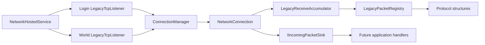

# Networking Implementation

## Scope

This stage implements TCP transport only. The Node.js reference uses `net.createServer` for separate login and world listeners and has no UDP, TLS, compression, encryption, or application heartbeat implementation.

The C# transport:

- accepts unauthenticated TCP connections;
- stores connection identity and remote endpoint;
- receives TCP byte streams;
- frames the original 9-byte receive header plus fixed payload;
- delivers complete frames through an application sink;
- sends bounded asynchronous frames;
- removes/disposes connections exactly once;
- identifies whether each connection belongs to the login or world listener;
- delegates login authentication/session association to the application layer;
- does not implement character sessions, world transfer, or players.

## Listener configuration

`InfiniteSky:Networking` settings:

| Setting | Default | Validation |
|---|---:|---|
| `Enabled` | false | false disables listeners |
| `BindAddress` | 127.0.0.1 | valid IP address |
| `LoginPort` | 11091 | 1-65535 |
| `WorldPort` | 11092 | 1-65535 and different |
| `MaxConcurrentConnections` | 100 | 1-100000 |
| `MaxReceiveBufferBytes` | 10240 | 9-16777216 |
| `MaxFrameBytes` | 10240 | 9-16777216 and no greater than `MaxReceiveBufferBytes`; includes the 9-byte receive header |
| `SendQueueCapacity` | 64 | 1-10000 frames |
| `IdleTimeoutSeconds` | 120 | 0-86400; 0 disables idle timeout |
| `ConnectionShutdownTimeoutSeconds` | 30 | 1-300 seconds |

Environment variables use the standard prefix:

```text
INFINITESKY_InfiniteSky__Networking__Enabled=true
INFINITESKY_InfiniteSky__Networking__BindAddress=127.0.0.1
INFINITESKY_InfiniteSky__Networking__LoginPort=11091
INFINITESKY_InfiniteSky__Networking__WorldPort=11092
```

## Architecture



The protocol project owns frame opcode/layout knowledge. The networking project owns only transport and transport lifecycle.

## Listener lifecycle

`NetworkHostedService` is a server-host hosted service.

Startup:

1. validate options;
2. create a shared connection manager;
3. create login and world `LegacyTcpListener` instances;
4. start login listener;
5. start world listener;
6. set lifecycle Networking check to `Listening`.

Shutdown:

1. remove readiness first;
2. stop both listeners;
3. close active connections within timeout;
4. dispose listener and connection resources;
5. set networking check to `Stopped`.

Startup listener bind failures propagate to the host. There is no silent listener fallback.

## Connection lifecycle

States:

- `Accepted`
- `Initialising`
- `Connected`
- `Closing`
- `Closed`
- `Faulted`

A connection is identified by `NetworkConnectionId`, retains its `IPEndPoint` and `NetworkEndpointKind` (`Login` or `World`), and owns one TCP stream. Authentication state remains in the application layer.

Registration and removal use `ConnectionManager`. The limit is enforced before `NetworkConnection.Start`.

An excess connection is disposed and logged; it is not placed in a queue.

## Receive pipeline

`LegacyReceiveAccumulator`:

- retains at most `MaxReceiveBufferBytes`;
- waits for at least 9 bytes;
- reads opcode at byte 8;
- looks up fixed payload size in `LegacyPacketRegistry`;
- rejects a known frame whose total header-plus-payload size exceeds `MaxFrameBytes`;
- waits for the exact payload;
- emits complete `LegacyProtocolFrame` records;
- handles multiple complete frames in one read;
- reports unknown opcode separately;
- discards exactly 9 bytes for an unknown opcode.

TCP reads use cancellation and `ReadAsync`. An idle read cancellation is enabled when `IdleTimeoutSeconds > 0`. The setting is transport idle timeout only, not application heartbeat.

Incomplete input is retained until more bytes arrive or the connection closes.

## Send pipeline

Every connection owns one bounded send queue. Enqueued frames are copied so a caller cannot mutate bytes after handing them to the transport. `SendAsync` waits for queue capacity and for the frame to be written/flushed; `TrySend` only reports whether a frame entered the queue. `TrySend` returns false when the channel is full or closed and does not distinguish those cases.

One receive loop and one send loop may operate concurrently. One send loop owns `NetworkStream.WriteAsync`, preventing interleaved writes. Concurrent producers are serialized by the bounded channel in enqueue order; the relative order of calls racing to enqueue is not guaranteed.

Send failures are logged and move the connection to `Faulted`.

## Backpressure

The send queue is bounded. It is not an unlimited per-socket buffer.

Current behavior:

- `SendAsync` waits for queue capacity and completion of the network write;
- cancellation after enqueue closes the connection to avoid a late response being sent after the caller has abandoned it;
- `TrySend` rejects when channel capacity is unavailable;
- no application handler consumes queue overflow yet;
- queue overflow should close or throttle a connection in a future application policy rather than silently drop data.

Receive buffer overflow closes with an exception because it would exceed `MaxReceiveBufferBytes`.

## Heartbeat

The Node implementation registers login `0x04` as an 8-byte keepalive but does not implement a timeout loop. The C# transport has a configurable idle TCP-read timeout and does not invent application ping/pong packets.

It does not implement TCP KeepAlive socket options; the idle timeout is transport read inactivity only.

## Dispatch boundary

`IIncomingPacketSink` receives:

- complete frame bytes and opcode;
- unknown opcode separately.

The Server uses `AuthenticationIncomingPacketSink` for the login endpoint's `0x03` request. It delegates authentication and session state to the application layer and leaves other frames unhandled. The world endpoint does not interpret login opcodes as authentication.

## Diagnostics

`NetworkingMetrics` currently records real events:

- accepted/disconnected connections;
- receive/send failures;
- frames received/sent;
- bytes received/sent;
- active connection count.

The logger records listener, connection, framing, receive, send, reject, and idle events. Packet payload bytes and authentication values are not logged.

## Tests

Loopback tests cover:

- receive fragmentation and coalescing;
- complete, partial, unknown, and oversized receive buffers;
- TCP listener accept/send;
- remote disconnect removal;
- connection limit rejection;
- listener shutdown.

Tests use ephemeral ports only for internal listener tests.

## Limitations

- login authentication is implemented, but other login/world packet handlers remain future work;
- no character/world session transfer;
- no UDP listener;
- no TLS;
- no packet checksum/encryption;
- no TCP KeepAlive configuration;
- no application heartbeat;
- unknown-opcode payload is discarded at the 9-byte header boundary;
- fixed registry has no complete Character/world packet layouts;
- listener port 0 is useful in tests but production options validator rejects it.
