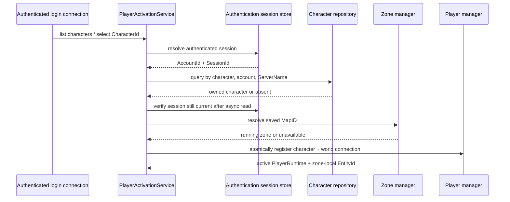

# Player Session and World Entry

## Current C# activation flow

`GetCharactersAsync` and `ActivateAsync` require the login connection to exist in `IAuthenticationSessionStore`. The database filter enforces account ownership and configured `ServerName`; the application boundary rechecks the returned `AccountId` and verifies that the same authentication session still exists after database I/O. Character selection is explicit by persistent `CharacterId`; the service never chooses the first character automatically.

Activation requires a complete saved `MapID`, `RealX`, `RealY`, and `RealZ`, plus a running configured zone. It does not use a client-supplied map, invent fallback coordinates, calculate missing stats, or construct a success-shaped player when persistence is incomplete.

The manager prevents concurrent duplicate activation by character, authentication-session ID, and world-connection ID. The player runtime stores only session/connection identifiers and character state, not credentials.

## Disconnect and shutdown

`DisconnectAsync` removes world-connection, character, session, and zone-spatial ownership once, captures a snapshot, then persists only saved world location. Repeated disconnect returns no player. Graceful host shutdown stops network ingress, calls `PlayerManagementHostedService`, removes all active players and saves their location snapshots, then stops the world and zones.

The explicit activation service is not currently called by an incoming world protocol handler. Network disconnect cleanup therefore exists as a tested application boundary, not a fully wired client path. The current authentication session store is process-local and tied to the login connection; distributed sessions, reconnect semantics, and transfer-token behavior remain unimplemented.

## Original behavior and compatibility boundary

The root login path queries characters by account and server and sends at most three `0x05` character-list records. The `0x09` GameStart request selects a slot; the legacy handler uses the character's saved `MapID`, then queues the authenticated login socket for transfer. The world `0x01` handshake supplies a username, slot, and map ID; the root implementation matches the pending transfer by username and does not reliably validate the slot/map against it.

The C# boundary deliberately does not reproduce that weak username-only handoff. It requires the already authenticated login session and checks character ownership. It also does not emit `0x05`, `0x0A`, world-entry `0x15`/`0x16`/`0x17`, spawn, or despawn packets: the full Character codec, derived-stat initialization, and world packet handlers are missing. Thus it establishes the server-side activation boundary only and does not claim original-client world-entry compatibility.

## Tests and remaining questions

`PlayerActivationServiceTests` covers authenticated listing, foreign-account rejection, session expiration during repository I/O, runtime binding, disconnect location persistence, repeated disconnect, and shutdown removal/save. `DependencyInjectionTests` checks singleton registration and host ordering.

Unresolved: should a future secure transfer token replace username matching without requiring a client change; how long the login connection remains open after handoff; whether reconnect reuses or replaces an active character; and which source packet errors must be returned for unavailable characters/zones.

## References

- [`handleLogin.js`](../../packets/login/handleLogin.js) — source character listing.
- [`handleGameStart.js`](../../packets/login/handleGameStart.js) — source slot selection and transfer queue.
- [`handshake.js`](../../packets/world/handshake.js) — source world transfer handshake.
- [`AuthenticationSessionStore.cs`](../../src/InfiniteSky.Application/Authentication/InMemoryAuthenticationSessionStore.cs) — authenticated login session ownership.
- [`PlayerActivationService.cs`](../../src/InfiniteSky.Application/Players/PlayerActivationService.cs) — C# loading/ownership boundary.
- [`PlayerManagementHostedService.cs`](../../src/InfiniteSky.Server/Hosting/PlayerManagementHostedService.cs) — graceful player cleanup/save ordering.
