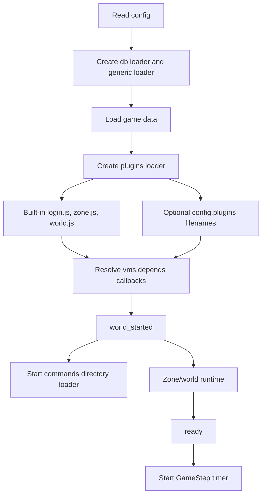

# Plugin and Script Lifecycle

## Root Node.js lifecycle

The root system calls its loaders plugins, but source evidence shows VMScript-managed filenames and globals rather than a conventional plugin framework.

In source:

1. `main.js` loads config, creates the Mongoose wrapper and `generic` VMScript loader.
2. The database connection callback creates the `db` loader. `main.js` creates the `cli` loader.
3. After the `GameInfoLoader` emits `load`, `main.js` builds a filename list containing `login.js`, `zone.js`, `world.js` and each configured `config.plugins` entry, then constructs the `plugins` VMScript.
4. The plugin script dependency declarations gate execution on global names such as `Info_Item`, `Character`, `Packets`, `Zone`, and `Account`.
5. `world_started` starts the `commands/` loader. World zone loading later emits `ready`; `GameStep` then emits `step` every 100 ms.

VMScript's directory enumeration is asynchronous. File enumeration order is not made deterministic by a source-level sort. Dependency names partially order callback execution but there is no plugin version resolver, cycle diagnostic, capability negotiation or transactional startup.

## Reload, unload, failures and shutdown

The root VMScript installs persistent filesystem watchers and applies a minimum one-second revision window. Reload re-evaluates changed source; the custom module path may replace a global and call a `transfer()` method. The active `unloadFile` removes only bookkeeping entries. The source does not establish an unload callback that reliably removes event subscriptions, stops timers, disposes service handles or rolls back mutations.

Script syntax/initialization and dependency callback errors are logged. In `loadFile`, the loaded-file count advances after a script exception, so a failed script is not equivalent to a successful module and does not necessarily abort startup. There is no per-script shutdown or cancellation lifecycle in the root VMScript.

`main.shutdown()` emits the application `Shutdown` event, invokes registered shutdown methods and exits. No VMScript watcher shutdown is registered. This is distinct from plugin deactivation.

## FruitSalad alternative

`FruitSalad/main.js` reads `Config/processes.json` and joins configured child processes. `rpc.js` forks `Processes/process.js`, exchanges BSON objects with a four-byte little-endian length prefix and invalidates remote APIs. A child calls `api.spawnScript(script)` to watch its process script. The alternate `VMScript.js` manages its own shared process-global loader state and watches JS/JSON files.

This process model is not a drop-in isolation layer for root scripts: root modules share live socket, world, database and entity object references in one process, while RPC transfers serialized values/callback identifiers. Do not merge these lifecycles without a source-backed API and ordering contract.

## .NET lifecycle decision

No plugin/script lifecycle implementation is registered in the .NET Generic Host. Existing C# services are composed by dependency injection and hosted-service ordering; no legacy script is discovered or activated. Do not add discovery, activation, deactivation, hot reload or plugin dependency semantics until a concrete source module has an owned C# boundary and executable parity tests.
