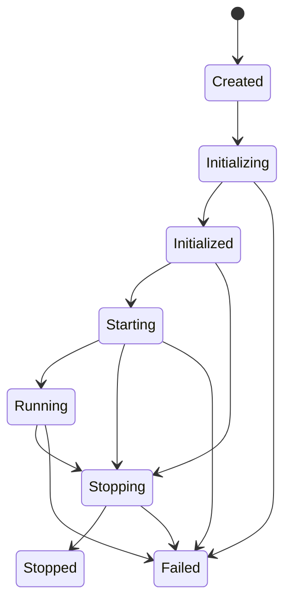
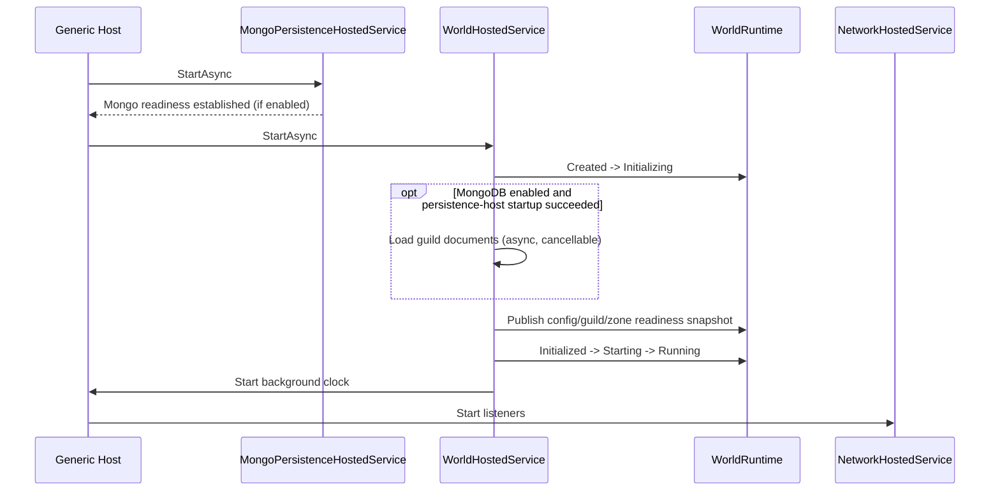

# World Lifecycle

## State model

`WorldRuntime` is a single process-local lifecycle state holder. State transitions are guarded by a private lock and snapshots are copied for readers.

`Failed`, `Stopped`, and `Created` are terminal for this host instance; a failed world is not retried in place. A second hosted-service start request is idempotent only after the runtime is already running. A second initialization attempt in any other state fails explicitly.

Readiness is separate from lifecycle state:

| Condition | Runtime state/readiness | Health |
|---|---|---|
| Before host initialization | `Created` / `NotInitialized` | Degraded |
| During initialization | `Initializing` / `Initializing` | Degraded |
| Running with all known dependencies | `Running` / `Ready` | Healthy |
| Running without guild data or zone runtime | `Running` / `Degraded` | Degraded |
| Stopping or stopped | `Stopping` / `Stopped` | Unhealthy |
| Startup/runtime failure | `Failed` / `Failed` | Unhealthy |

Readiness blockers are explicit (`GuildDataUnavailable`, `ZoneRuntimeUnavailable`). There is no registered zone provider today, so startup does not claim full world readiness.

## Host startup sequence

`ServerHostBuilder` registers persistence, world, then networking hosted services. The Generic Host starts them in registration order and stops them in reverse order. Thus networking stops before world and persistence. No networking listener is owned by the world domain.

The Generic Host's concurrent service startup/shutdown options are rejected by configuration validation because they would violate these dependency orderings.

## Shutdown and errors

The hosted service marks the world `Stopping`, cancels/awaits its background clock through `CoordinatedBackgroundService`, then marks it `Stopped`. A background tick failure marks the runtime failed and is surfaced to the Generic Host's `StopHost` policy. Cancellation during shutdown is propagated rather than disguised as success.

There are no independently allocated world resources to dispose in this stage. MongoDB client ownership remains with the existing persistence host. World metrics are DI-owned and disposed with the service provider.

The original [`world.js`](../../world.js#L15-L40) starts the listener, begins zone loading and guild preparation, then emits `world_started`; zone queue completion separately emits `ready` ([`world.js`](../../world.js#L783-L806)). The original guild query callback is not awaited and returns after logging a query error ([`world.js`](../../world.js#L937-L962)). The C# host deliberately has an explicit lifecycle and awaited cancellable database read, while treating a guild-query failure as degraded rather than fatal. A MongoDB persistence-host startup failure occurs earlier and prevents world startup.

The original cadence is a 100 ms `setInterval` with elapsed time derived from `process.hrtime` ([`GameStep.js`](../../GameStep.js#L5-L30)). The C# `WorldClock` uses `PeriodicTimer` and a measured monotonic delta. It currently waits for cancellation when the world snapshot is not fully ready; without the future zone readiness integration, the server does not run zone simulation.

## Concurrency assumptions

- Lifecycle methods and snapshot reads are thread-safe.
- Snapshot state is immutable to callers; guild lookup uses an ordinal comparer.
- Tick handlers run sequentially and are awaited; no overlapping tick callbacks are started by the clock.
- No network/database call is made under the runtime lock.
- Runtime initialization is a one-shot operation per host process.

These are lifecycle guarantees only; they do not establish zone/entity concurrency semantics.
