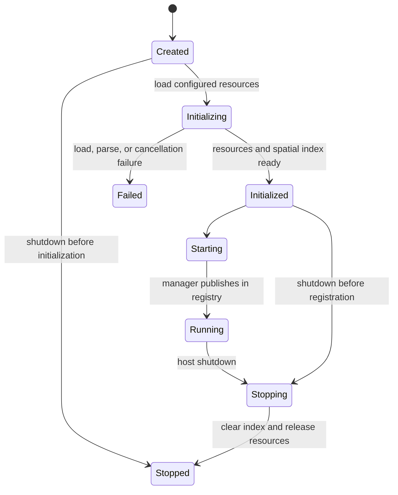
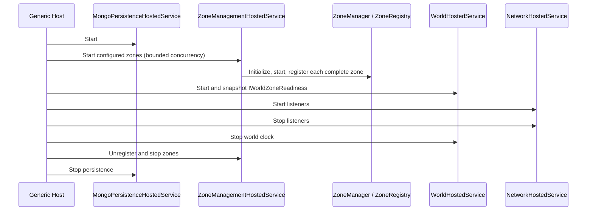

# Zone Lifecycle

## Lifecycle model

`ZoneRuntime` owns its state and resource snapshot. It exposes spatial operations only after initialization. Initialization is idempotent for repeated calls; startup is idempotent while Running; invalid state transitions fail explicitly. A Failed zone is not registered.

## Startup and shutdown ordering

The registration sequence is in [`ServerHostBuilder`](../../src/InfiniteSky.Server/Hosting/ServerHostBuilder.cs#L78-L103); world startup consumes the provider before networking ([`WorldHostedService`](../../src/InfiniteSky.Server/Hosting/WorldHostedService.cs#L88-L109)). Generic Host stop ordering is reversed, so the world stops before zones and listeners stop before the world.

## Configuration and readiness

`ZoneManagementHostedService` resolves each `InfiniteSky:Zones:Load` value through the exact original catalog. It then maps the source defaults—load concurrency 4, QuadTree depth 6, node limit 10, viewable action distance 500—to `ZoneManagerOptions`. Invalid numeric settings and duplicate or nonpositive IDs are rejected.

The manager only reports ready when at least one zone was selected and every configured zone is in Running state and published. Empty configuration is valid but reports degraded zone health and causes the world to report `ZoneRuntimeUnavailable`; it does not create a placeholder zone. Zone health reports configured, loaded, and failed counts and is additionally degraded when optional legacy NPC or region files are missing, even though their absence does not block the original-compatible lifecycle.

## Failure, cancellation, and cleanup

- Loading is bounded by `Parallel.ForEachAsync` and the configured concurrency. Every load receives the host cancellation token.
- Missing `.NPC` and `.WREGION` files are optional, matching the source loader. File I/O failures other than missing files, truncated count-prefixed records, and invalid configured IDs fail startup.
- A zone is added to the registry only after resources and spatial index initialize and its lifecycle reaches Running. Duplicate registrations return failure and abort startup.
- On startup failure, registered zones are unpublished and stopped; cleanup errors are aggregated with the startup error rather than silently discarded.
- Shutdown removes zones from the registry before disposing their spatial indexes. No zone-level database or network operations are performed.
- `ZoneRuntime.StopAsync` rejects shutdown during active initialization; host startup is sequential, and `ZoneManager` awaits all loader work before its startup operation completes.

## Legacy lifecycle differences and limitations

The Node.js loader uses an `async.queue` with concurrency default 4 and marks a zone loaded after its NPC, move-region, and safe-region steps complete ([`world.js`](../../world.js#L783-L806), [`zone.js`](../../zone.js#L533-L676)). Missing files do not fail those steps. Duplicate loading during initialization is explicitly a TODO, aliases are TODO, and `world.unloadZone` calls a missing `Zone.unload` implementation ([`world.js`](../../world.js#L804-L829)).

The C# lifecycle is deterministic and cleans up its own resources, but it does not implement entity/timer/save draining because those systems are outside this stage. In particular, it does not claim full graceful shutdown parity for an active game zone.
